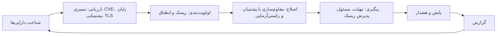

# معرفی محصول NGCorion

| مورد | مقدار |
|---|---|
| محصول | NGCorion — سامانهٔ ممیزی، مقاوم‌سازی و مدیریت وضعیت امنیتی زیرساخت |
| نسخه | 2.1.0 و قابلیت‌های افزوده‌شده پس از آن در شاخهٔ اصلی (بخش «Unreleased» در `CHANGELOG.md`) |
| نسخهٔ سند | 1.0 |
| مخاطب | مدیران فناوری اطلاعات و امنیت، تصمیم‌گیران خرید، کارشناسان شبکه و امنیت، ممیزان |
| اسناد مرتبط | [دورهٔ آموزشی](TRAINING_GUIDE.md)، [راهنمای کاربر](USER_GUIDE.md)، [راهنمای مدیر](ADMIN_GUIDE.md)، [سند معماری امنیتی](ARCHITECTURE.md)، [هدف امنیتی](../SECURITY_TARGET.md) |

این سند NGCorion را معرفی می‌کند: چه مسئله‌ای را حل می‌کند، چگونه کار می‌کند، و هر ماژول دقیقاً چه
قابلیت‌هایی دارد. برای یادگیری گام‌به‌گام کار با نرم‌افزار، [دورهٔ آموزشی](TRAINING_GUIDE.md) را ببینید.

---

## ۱. NGCorion در یک نگاه

NGCorion سامانه‌ای تحت وب است که روی شبکهٔ خود سازمان نصب می‌شود و چرخهٔ کامل امنیت زیرساخت را یک‌جا
پوشش می‌دهد:

* **می‌شناسد:** فهرست دارایی‌ها (سرورها، تجهیزات شبکه، پایگاه‌های داده، سرویس‌ها) را می‌سازد و به‌روز
  نگه می‌دارد؛ با کشف شبکه، فهرست نرم‌افزار، جدول‌های ARP/MAC و همسایه‌های LLDP/CDP.
* **می‌سنجد:** پیکربندی ۱۷ خانوادهٔ فناوری را با معیارهای مرجع (CIS، DISA STIG و راهنمای سازندگان)
  ممیزی می‌کند؛ بیش از ۲٬۰۰۰ کنترل امنیتی. آسیب‌پذیری‌های شناخته‌شده (CVE)، پایان پشتیبانی نرم‌افزارها و
  گواهی‌های TLS را هم بررسی می‌کند.
* **اصلاح می‌کند:** تنظیمات امن را با پیش‌نمایش، پشتیبان پیش از تغییر و راستی‌آزمایی پس از آن روی
  دستگاه اعمال می‌کند.
* **پیگیری می‌کند:** برای هر یافته مسئول و مهلت تعیین می‌کند، استثناها را با تأیید رسمی ثبت می‌کند و
  انطباق با PCI DSS، ISO/IEC 27001 و NIST SP 800-53 را نشان می‌دهد.
* **پایش می‌کند:** دسترس‌پذیری و سلامت دستگاه‌ها (SNMP)، Syslog، تغییرهای پیکربندی و دستگاه‌های ناشناس
  روی شبکه.
* **گزارش می‌دهد:** ۱۷ قالب گزارش PDF و Excel (فارسی با تاریخ شمسی یا انگلیسی)، زمان‌بندی‌شده و قابل
  راستی‌آزمایی؛ و ۴۵ رویداد هشدار با ارسال به ایمیل، پیامک، SIEM و وب‌هوک.

### ۱.۱ چرا NGCorion

| نیاز سازمان | پاسخ NGCorion |
|---|---|
| «نمی‌دانیم دقیقاً چه چیزهایی در شبکه داریم.» | فهرست دارایی‌ها از کشف شبکه، جدول‌های ARP و MAC روترها و سوئیچ‌ها، LLDP/CDP و فهرست نرم‌افزار ساخته می‌شود؛ دستگاه تازه روی شبکه هشدار می‌دهد. |
| «ممیزی دستی ده‌ها سرور و تجهیز هفته‌ها طول می‌کشد.» | ممیزی خودکار با بنچمارک‌های مرجع، گروهی و زمان‌بندی‌شده، با شاهد هر کنترل. |
| «اصلاح تنظیمات می‌ترسانَد؛ ممکن است سرویس قطع شود.» | پیش‌نمایش دقیق دستورها، پشتیبان پیکربندی پیش از تغییر، راستی‌آزمایی پس از اجرا و بازیابی با بازگشت خودکار. |
| «فهرست آسیب‌پذیری‌ها بی‌پایان است؛ از کجا شروع کنیم؟» | اولویت‌بندی بر اساس سوءاستفادهٔ واقعی (CISA KEV)، احتمال سوءاستفاده (EPSS) و CVSS، و امتیاز ریسک هر دارایی. |
| «یافته‌ها باز می‌مانند و کسی پیگیری نمی‌کند.» | پیگیری اصلاح با مسئول، مهلت بر اساس شدت، یادآوری و بسته شدن خودکار پس از تأیید رفع. |
| «ممیز می‌پرسد چقدر با PCI DSS یا ISO 27001 منطبقیم.» | امتیاز انطباق هر الزام از روی آخرین ممیزی‌ها، شکاف‌ها و ارزیابی دستی برای الزام‌های غیرفنی. |
| «پیکربندی دستگاه بی‌خبر تغییر کرد.» | پشتیبان‌گیری زمان‌بندی‌شده و پس از هر تغییر گزارش‌شده با Syslog، مقایسهٔ نسخه‌ها و هشدار «تغییر بیرون از NGCorion» با نام کسی که تغییر داد. |
| «شبکهٔ ما به اینترنت وصل نیست.» | لایسنس آفلاین، بستهٔ امضاشدهٔ آفلاین برای پایگاه دادهٔ CVE، فهرست پایان پشتیبانی داخلی؛ هیچ داده‌ای از سازمان بیرون نمی‌رود. |

### ۱.۲ ویژگی‌های متمایز

* **روی زیرساخت خود سازمان:** ماشین مجازی آماده یا Docker؛ داده‌ها از شبکهٔ سازمان خارج نمی‌شوند.
* **فارسی کامل:** رابط راست‌به‌چپ، اعداد فارسی، تقویم شمسی در رابط و گزارش‌ها؛ رابط انگلیسی هم دارد.
* **ایمن در طراحی:** کمترین دسترسی، ثبت تغییرناپذیر رویدادها، رمزنگاری رازها، پین کلید دستگاه‌ها، ورود
  دومرحله‌ای؛ مستندات بر پایهٔ الزامات معیار مشترک (Common Criteria) تهیه شده است.
* **اصلاح، نه فقط گزارش:** بیشتر ابزارها فقط مشکل را نشان می‌دهند؛ NGCorion آن را با کنترل کامل رفع
  می‌کند و رفع را راستی‌آزمایی می‌کند.
* **یک تصویر از هر دارایی:** صفحهٔ «۳۶۰ درجه» همه‌چیز دربارهٔ یک دارایی را از همهٔ ماژول‌ها کنار هم
  نشان می‌دهد.

---

## ۲. نقشهٔ ماژول‌ها

منوی سامانه به ترتیب کار چیده شده است. هر کاربر فقط بخش‌هایی را می‌بیند که مجوزشان را دارد.

| گروه منو | ماژول‌ها | بخش این سند |
|---|---|---|
| داشبورد و هشدارها | داشبورد، هشدارها | ۳.۱، ۳.۱۳ |
| دارایی‌ها | نمای کلی، فهرست دارایی‌ها و صفحهٔ ۳۶۰ درجه، گروه‌های دارایی، نرم‌افزارها و پایان پشتیبانی، کشف خودکار، زمان‌بندی کشف، الزامات امنیتی دارایی | ۳.۲ |
| ارزیابی امنیتی | نمای کلی ریسک، ریسک دارایی‌ها، نمای کلی ممیزی، اجرای ممیزی، ممیزی‌های گروهی، زمان‌بندی ممیزی، آسیب‌پذیری‌ها (CVE) و گواهی‌های TLS | ۳.۳، ۳.۵، ۳.۶ |
| اصلاح و مقاوم‌سازی | نمای کلی مقاوم‌سازی، اجرای مقاوم‌سازی، پیگیری اصلاح، ریسک‌های پذیرفته‌شده، سیاست بنچمارک‌ها، انطباق با استانداردها | ۳.۴، ۳.۷ |
| پشتیبان دستگاه‌ها | نمای کلی، پشتیبان‌ها، تاریخچهٔ بازیابی، زمان‌بندی پشتیبان‌گیری | ۳.۸ |
| شبکه و پایش | وضعیت شبکه (NOC)، میزبان‌ها، دستگاه‌های ناشناس، Syslog، توپولوژی، طرح پیشنهادی، اعتبارسنجی معماری | ۳.۹، ۳.۱۰ |
| گزارش‌ها | ساخت گزارش، بایگانی، زمان‌بندی‌ها | ۳.۱۲ |
| مدیریت سامانه | کاربران و کلیدهای API، پیکربندی سیستم، قواعد هشدار و اعلان، پایگاه دادهٔ آسیب‌پذیری، لایسنس، پشتیبان‌گیری از NGCorion، لاگ‌ها و سوابق ممیزی | ۳.۱۴ تا ۳.۱۸ |

کادر **جستجوی سراسری** بالای همهٔ صفحه‌ها (بخش ۳.۱۱) به همهٔ این ماژول‌ها راه دارد.

---

## ۳. معرفی کامل ماژول‌ها

### ۳.۱ داشبورد

نقطهٔ شروع هر روز کاری؛ هر کارت به صفحهٔ جزئیات خود، با فیلتر مربوط، پیوند دارد و هر کاربر فقط بخش‌های
ماژول‌های مجاز خود را می‌بیند:

* **امتیاز ریسک امنیتی سازمان** (۰ تا ۱۰۰) با مقیاس رنگی (حداقلی ۰–۹، پایین ۱۰–۲۴، متوسط ۲۵–۳۹، بالا ۴۰–۵۹،
  بحرانی ۶۰–۱۰۰)، تغییر ۳۰ روزهٔ میانگین ریسک دارایی‌ها، و **اجزای امتیاز**: ریسک و وزن شش بخش آن؛
* تعداد دارایی‌های فهرست، دارایی‌های با ریسک بحرانی و دارایی‌های در معرض اینترنت؛
* **نیازمند اقدام:** آسیب‌پذیری‌های مورد سوءاستفادهٔ واقعی، هشدارهای بحرانی تأییدنشده، دستگاه‌های بی‌پاسخ،
  موارد اصلاحی گذشته از مهلت، گواهی‌های منقضی یا رو به انقضا، نرم‌افزار بدون پشتیبانی، تغییر پیکربندی بیرون
  از NGCorion، کارهای زمان‌بندی‌شدهٔ ناموفق، شکست پشتیبان سامانه و درخواست‌های در انتظار تأیید؛
* **پوشش:** درصد دارایی‌های ممیزی‌شده، دارای پشتیبان پیکربندی تازه و پایش‌شده؛
* **روند ۹۰ روزه** ریسک و انطباق (از آخرین مقدار هر دارایی در هر لحظه)؛
* **۱۰ دارایی پرریسک** با عاملی که بیشترین سهم را در امتیاز هر کدام دارد.

### ۳.۲ دارایی‌ها

«نمای کلی دارایی‌ها» تعداد و دارایی‌های تازه، مصرف لایسنس، دستگاه‌های ناشناس شبکه، اطلاعات ناقص (بدون مالک،
IP، سیستم‌عامل، مکان یا ناحیهٔ ریسک)، پوشش ماژول‌ها (ممیزی، پشتیبان، پایش، پایان پشتیبانی) و ترکیب دارایی‌ها را
نشان می‌دهد؛ هر عدد فهرست دارایی‌ها را با فیلتر همان دارایی‌ها باز می‌کند.

#### ۳.۲.۱ فهرست دارایی‌ها

پایهٔ همهٔ ماژول‌های دیگر. هر دارایی نام، نام میزبان، نشانی IP و MAC، نوع (با آیکون)، سیستم‌عامل و
نسخه، سازنده و مدل، شمارهٔ سریال، مکان (سایت، طبقه، اتاق، رک)، مالک، ناحیهٔ شبکه، سطح محرمانگی و اهمیت،
تعداد پورت فیزیکی و میزبان (برای ماشین‌های مجازی) دارد.

* افزودن دستی، **ورود گروهی از Excel** با الگوی آماده و گزارش ردیف‌های نادرست، **برون‌بری Excel** با
  خنثی‌سازی فرمول‌های خطرناک.
* **برچسب‌ها** (مثلاً `pci`، `web`) و **تغییر گروهی**: افزودن یا حذف برچسب، تعیین مالک، مکان، وضعیت،
  ناحیهٔ ریسک، افزودن به گروه، و حذف با تأیید تعداد.
* **تاریخچهٔ تغییرات** هر دارایی: چه کسی، چه چیزی، چه زمانی.
* **سقف لایسنس:** دارایی تازه بیش از سقف لایسنس افزوده نمی‌شود؛ دارایی‌های بیرون از پوشش با برچسب «خارج
  از لایسنس» نشان داده می‌شوند.

#### ۳.۲.۲ صفحهٔ دارایی (نمای ۳۶۰ درجه)

همه‌چیز دربارهٔ یک دارایی در یک صفحه، از همهٔ ماژول‌ها:

* سربرگ با نوع، وضعیت، IP، برچسب‌ها، گروه‌ها و پیوند به ریسک، پشتیبان‌ها، SNMP و Syslog؛
* کارت‌های خلاصه: امتیاز ریسک، درصد انطباق آخرین ممیزی، آسیب‌پذیری‌ها (اصلاح فوری و در حال
  بهره‌برداری)، موارد اصلاح باز و گذشته از مهلت، آخرین پشتیبان و تغییرهای بیرون از NGCorion، وضعیت پایش؛
* هشدارهای باز همین دارایی؛
* بخش‌های ممیزی‌ها، آسیب‌پذیری‌ها و گواهی‌های TLS، پیگیری اصلاح، پشتیبان‌ها با «چه تغییر کرد»، مشخصات،
  پایش، اتصال‌های توپولوژی، نرم‌افزارها با وضعیت پشتیبانی سازنده، و مقاوم‌سازی‌ها؛
* **روند اجرا:** هر اتفاقی که برای دارایی افتاده، از همهٔ ماژول‌ها، در یک خط زمانی.

هر بخش فقط برای کسی دیده می‌شود که به ماژول آن دسترسی خواندن دارد.

#### ۳.۲.۳ گروه‌های دارایی

* **گروه پویا** با شرط‌هایی مثل نوع، ناحیه، مالک، مکان، وضعیت، سیستم‌عامل، سازنده، نام، برچسب و بازهٔ
  IP به صورت CIDR؛ دارایی تازه‌ای که با شرط‌ها جور باشد خودبه‌خود عضو می‌شود.
* **گروه ثابت** با انتخاب دستی دارایی‌ها.
* گروه‌ها در ممیزی گروهی، پشتیبان‌گیری زمان‌بندی‌شده، سیاست بنچمارک، انطباق با استانداردها و گزارش‌ها به
  کار می‌روند.

#### ۳.۲.۴ کشف خودکار

اسکن شبکه با nmap برای یک IP، بازهٔ CIDR یا بازهٔ نشانی، با سه حالت «پورت‌های شناخته‌شده»، «همهٔ پورت‌ها» و
«پورت‌های سفارشی». میزبان‌های یافته‌شده با پورت‌ها و سرویس‌هایشان نمایش داده می‌شوند و می‌توان هر کدام را
دارایی تازه کرد یا اطلاعاتش را روی دارایی موجود اعمال کرد. **کشف زمان‌بندی‌شده** همین اسکن را یک بار،
ساعتی، روزانه یا هفتگی اجرا می‌کند. پورت‌های باز در امتیاز ریسک و در اسکن گواهی‌های TLS به کار می‌روند.

#### ۳.۲.۵ نرم‌افزارها

فهرست نرم‌افزارها و بسته‌های نصب‌شده روی دارایی‌ها که هنگام ممیزی یا با «جمع‌آوری همین حالا» خوانده
می‌شود: بسته‌های توزیع لینوکس، برنامه‌های Windows، سرویس‌ها و میان‌افزار تجهیزات. نسخه‌های آسیب‌پذیر و
به‌روزرسانی‌های امنیتی موجود مشخص‌اند. هشدار «نرم‌افزار تازه بیرون از مخزن‌های شناخته‌شده» نصب‌های دستی
یا از مخزن ناآشنا را خبر می‌دهد.

#### ۳.۲.۶ پایان پشتیبانی

نشان می‌دهد سیستم‌عامل، میان‌افزار و نرم‌افزار سرور هر دارایی تا کی از سازنده وصلهٔ امنیتی می‌گیرد.

* **فهرست مرجع:** ۲۴ محصول و ۴۵۵ چرخهٔ انتشار از endoflife.date، همراه نرم‌افزار و بدون نیاز به
  اینترنت؛ از جمله Ubuntu، Debian، RHEL و هم‌خانواده‌ها، SUSE، Windows Server، Windows، FortiOS، Cisco IOS XE،
  VMware ESXi، SQL Server، PostgreSQL، MySQL، MongoDB، Apache، nginx، Kubernetes و Docker Engine.
* **وضعیت‌ها:** بدون پشتیبانی، فقط پشتیبانی تمدیدی پولی (ESM، ESU)، پایان ظرف دورهٔ هشدار (پیش‌فرض ۱۸۰
  روز)، دارای پشتیبانی، و ناشناخته.
* **به‌روزرسانی:** برخط از endoflife.date یا با درون‌ریزی فایل در شبکهٔ بسته؛ **محصول خود سازمان** برای
  آنچه endoflife.date ندارد (مثلاً Sophos Firewall OS)؛ **ثبت دستی** تاریخ برای تجهیزات بدون فهرست
  نرم‌افزار (دوربین، کنترل‌گر).
* **اتصال:** یافتهٔ پیگیری اصلاح، عامل امتیاز ریسک، دو رویداد هشدار و گزارش «پایان پشتیبانی».

#### ۳.۲.۷ الزامات امنیتی دارایی

اطلاعات پایه‌ای که هنگام ثبت دارایی به کار می‌رود: انواع دارایی با آیکون، مکان‌ها، سیستم‌عامل‌ها، مالکان،
سازندگان و ناحیه‌های شبکه.

### ۳.۳ ممیزی

ممیزی پیکربندی دارایی را با معیار مرجع مقایسه می‌کند و **فقط می‌خواند**؛ چیزی را روی دارایی تغییر
نمی‌دهد. حاصل آن امتیاز انطباق و برای هر کنترل نتیجه، شدت، **شاهد** (آنچه از دستگاه خوانده شد) و توصیهٔ
اصلاح است.

#### ۳.۳.۱ فناوری‌های پشتیبانی‌شده

| دسته | فناوری | نسخه‌ها | اتصال | معیار مرجع |
|---|---|---|---|---|
| شبکه و امنیت | Cisco IOS | — | SSH | CIS Cisco IOS 15 Benchmark |
| شبکه و امنیت | FortiGate (با پشتیبانی از VDOM) | — | SSH | CIS FortiGate Benchmark |
| شبکه و امنیت | Sophos Firewall | — | HTTPS API | راهنمای مقاوم‌سازی Sophos |
| سرور و سیستم‌عامل | Windows Server | 2016، 2022، 2025 | WinRM | CIS Microsoft Windows Server |
| سرور و سیستم‌عامل | Linux | Ubuntu 20.04/22.04/24.04 LTS؛ Red Hat 8/9/10؛ Rocky Linux 8/9/10 | SSH | CIS برای هر توزیع |
| پایگاه داده | SQL Server | 2016، 2019، 2022 | ورود SQL Server | CIS Microsoft SQL Server |
| پایگاه داده | MongoDB | — | SSH و ورود MongoDB | CIS MongoDB |
| پایگاه داده | MySQL 8 | — | SSH و ورود MySQL | CIS Oracle MySQL Community Server 8.0 |
| وب | Apache | — | SSH | CIS Apache HTTP Server 2.4 |
| وب | NGINX | — | SSH | CIS NGINX |
| وب | IIS 10 | — | WinRM | CIS Microsoft IIS 10 |
| کانتینر و مجازی‌سازی | Docker | — | SSH | CIS Docker |
| کانتینر و مجازی‌سازی | Kubernetes | — | SSH | CIS Kubernetes |
| کانتینر و مجازی‌سازی | VMware ESXi | — | SSH | CIS VMware ESXi 7/8 |
| دایرکتوری و سرویس‌ها | Active Directory | — | WinRM | CIS Windows Server (پروفایل کنترل‌کنندهٔ دامنه) و کنترل‌های دامنه |
| دایرکتوری و سرویس‌ها | Windows DNS Server | — | WinRM | DISA STIG برای DNS ویندوز و راهنمای Microsoft |
| دایرکتوری و سرویس‌ها | Windows DHCP Server | — | WinRM | راهنمای امنیت و استقرار Microsoft |

#### ۳.۳.۲ شیوه‌های اجرا

* **ممیزی تکی:** انتخاب دارایی، فناوری (از روی دارایی پیشنهاد می‌شود)، اطلاعات ورود و اجرا. اطلاعات ورود
  فقط در طول همان اجرا به کار می‌رود و ذخیره نمی‌شود.
* **ممیزی گروهی:** یک گروه دارایی با یک **پروفایل اعتبارنامه** و ۱ تا ۵۰ ممیزی هم‌زمان؛ دارایی‌های ناموفق با
  دلیل (ورود رد شد، خارج از دسترس، خارج از پوشش لایسنس، بدون IP، خطا) و «تلاش دوباره» فقط برای آن‌ها.
* **ممیزی زمان‌بندی‌شده:** یک بار، ساعتی، روزانه یا هفتگی؛ برای یک دارایی یا یک گروه با پروفایل اعتبارنامه.
* **پروفایل اعتبارنامه:** اطلاعات ورود SSH، WinRM، SQL Server یا API سوفوس که مدیر سیستم می‌سازد؛
  فقط‌نوشتنی و رمزنگاری‌شده، با دورهٔ تعویض گذرواژه و هشدار.
* **پین کلید میزبان:** کلید SSH و گواهی HTTPS هر دستگاه در اولین اتصال ثبت می‌شود و اگر بعداً تغییر کند،
  اتصال **پیش از ارسال هر رمزی** رد می‌شود (دفاع در برابر جعل دستگاه).

#### ۳.۳.۳ نتیجهٔ ممیزی

امتیاز انطباق، تعداد کنترل‌های موفق، ناموفق و دستی، و برای هر کنترل شناسه و بند معیار، شدت، نتیجه، شاهد
و توصیه. گزارش PDF همان ممیزی با شاهد هر کنترل برای حسابرس ساخته می‌شود و از همان صفحه می‌توان به
مقاوم‌سازی کنترل‌های ناموفق رفت. هشدار «کاهش انطباق» افت امتیاز نسبت به ممیزی قبلی را خبر می‌دهد.

### ۳.۴ مقاوم‌سازی

مقاوم‌سازی تنظیمات امن را **روی دستگاه اعمال می‌کند**، با کنترل کامل:

1. **انتخاب:** کنترل‌های ناموفق یک ممیزی؛ کنترل‌هایی که اصلاح خودکار ندارند (مثلاً تنظیم فقط از راه GPO)
   دستورشان فقط برای کپی نمایش داده می‌شود.
2. **پارامترها:** برای کنترل‌هایی که مقدار لازم دارند (طول رمز، نشانی سرور Syslog و …)؛ با اعتبارسنجی
   سخت‌گیرانه (بازهٔ مجاز، فهرست گزینه‌ها، رد نویسه‌های خطرناک پوسته).
3. **پیش‌نمایش:** دستورهای دقیق، بدون اتصال به دستگاه.
4. **پشتیبان پیش از تغییر:** پیکربندی فعلی ذخیره می‌شود تا بازگشت ممکن باشد.
5. **اجرا و راستی‌آزمایی:** هر اصلاح فقط وقتی «موفق» است که دستورها بی‌خطا اجرا شوند **و** دستور
   راستی‌آزمایی نتیجهٔ درست بدهد.

«مقاوم‌سازی همه» همهٔ موارد قابل اصلاح یک ممیزی را با همین قواعد اجرا می‌کند. گزارش «تغییرات مقاوم‌سازی»
نشان می‌دهد چه تغییری، روی کدام دستگاه، توسط چه کسی و با کدام پشتیبان انجام شد.

### ۳.۵ آسیب‌پذیری‌ها و گواهی‌های TLS

#### ۳.۵.۱ یافته‌های CVE

* **منابع:** پایگاه دادهٔ محلی CVE از NVD، فهرست سوءاستفادهٔ واقعی CISA KEV، احتمال سوءاستفادهٔ FIRST EPSS، و
  اطلاعیه‌های امنیتی توزیع‌های لینوکس از OSV.
* **تطبیق:** محصولات و نسخه‌های هر دارایی (از فهرست نرم‌افزار و سیستم‌عامل) با محدوده‌های آسیب‌پذیر.
* **اولویت اصلاح:** ۱) در حال بهره‌برداری واقعی (KEV)، ۲) CVSS ۹ یا بالاتر یا EPSS ۵۰٪ یا بیشتر، ۳) CVSS ۷
  یا بالاتر یا EPSS ۱۰٪ یا بیشتر، ۴) بقیه. «اصلاح فوری» همان اولویت اول است.
* **نماها:** همهٔ یافته‌ها، بر اساس دارایی، و **بر اساس به‌روزرسانی** (نصب کدام به‌روزرسانی چند CVE را
  می‌بندد).
* **پایگاه داده:** به‌روزرسانی خودکار روزانه، یا برای شبکهٔ بدون اینترنت **بستهٔ آفلاین امضاشده با Ed25519**
  که فقط با کلید مورد اعتماد پذیرفته می‌شود.

#### ۳.۵.۲ گواهی‌های TLS

گواهی سرویس‌های TLS دارایی‌ها (وب، پنل مدیریت تجهیزات، ESXi، LDAPS، ایمیل و …) را با یک دست‌دهی ساده
می‌خواند، بدون رمز عبور و بدون تغییر روی دستگاه:

* **پورت‌ها:** 443، 465، 636، 993، 995، 3269، 5986، 8443، 9443، 10443 (قابل تغییر) و پورت‌هایی که کشف شبکه باز
  و دارای TLS دیده است؛ و سرویس‌هایی که دستی افزوده شوند (پورت دیگر یا نام سرور جداگانه با SNI).
* **بررسی‌ها:** منقضی‌شده یا رو به انقضا (پیش‌فرض ۳۰ روز)، نامعتبر (خودامضا یا صادرکنندهٔ ناشناس؛
  صادرکننده‌های داخلی سازمان قابل تعریف‌اند)، نام نادرست، کلید ضعیف (RSA زیر ۲۰۴۸ بیت)، امضای ضعیف
  (SHA-1 یا MD5) و پذیرش TLS 1.0 و 1.1.
* **اسکن:** خودکار هر ۲۴ ساعت یا با درخواست.
* **اتصال:** یافتهٔ پیگیری اصلاح، عامل ریسک، هشدارهای «گواهی منقضی شده» و «به‌زودی منقضی می‌شود»، گزارش
  «گواهی‌های TLS».

### ۳.۶ تحلیل ریسک

امتیاز ریسک ۰ تا ۱۰۰ برای هر دارایی، با وزن‌های قابل تنظیم:

| عامل | منبع | وزن پیش‌فرض |
|---|---|---|
| اهمیت دارایی | پروفایل ریسک و سطح محرمانگی | ۲۰٪ |
| ریسک ذاتی دارایی | سطح ریسک ثبت‌شده | ۱۵٪ |
| ناحیهٔ شبکه | ناحیه‌های ریسک (مثلاً DMZ، داخلی) | ۱۵٪ |
| پورت‌های باز | کشف شبکه یا ثبت دستی | ۱۰٪ |
| شکست ممیزی | سهم وزن‌دار کنترل‌های ناموفق آخرین ممیزی | ۲۰٪ |
| اصلاح شناسایی‌شده | کنترل‌های ناموفقی که اصلاحشان مشخص است | ۵٪ |
| آسیب‌پذیری‌های شناخته‌شده | بدترین مورد از: CVE (KEV ۱۰۰، بحرانی ۸۰، بالا ۵۵، بقیه ۲۵)، پایان پشتیبانی (بدون پشتیبانی ۸۰، فقط پولی ۴۰)، گواهی TLS (منقضی ۶۰، نامعتبر/ضعیف/TLS قدیمی ۳۰، نام نادرست ۱۰) | ۱۵٪ |

یافته‌هایی که ریسکشان رسماً پذیرفته شده، تا پایان مدت پذیرش از امتیاز بیرون می‌روند. تاریخچهٔ ریسک هر
دارایی و عامل هر تغییر نگه داشته می‌شود و تغییر اهمیت یا ناحیه دلیل می‌خواهد.

«نمای کلی ریسک» نشان می‌دهد ریسک از کدام عامل‌ها می‌آید (میانگین سهم هر عامل)، در کدام ناحیه‌ها و سطح‌هاست
(جدول ناحیه × سطح)، روند ۹۰ روزهٔ میانگین امتیاز و دارایی‌های بحرانی و بالا، دلیل امتیازهای ناقص با کار
رفع هر کدام، و ده دارایی پرریسک با عامل اصلی؛ هر عدد فهرست فیلترشدهٔ دارایی‌ها را باز می‌کند.

### ۳.۷ پیگیری اصلاح، سیاست بنچمارک و انطباق

#### ۳.۷.۱ پیگیری اصلاح

هر یافتهٔ باز از پنج منبع یک «مورد پیگیری» می‌شود: **ممیزی، CVE، اعتبارسنجی معماری، پایان پشتیبانی و
گواهی‌های TLS**. هر مورد مسئول (پیش‌فرض: مالک دارایی)، وضعیت (باز، در حال انجام، منتظر تأیید رفع، رفع و
تأییدشده، ریسک پذیرفته‌شده)، یادداشت‌ها و **مهلت بر اساس شدت** دارد:

| شدت | مهلت رفع پیش‌فرض | حداکثر مدت پذیرش ریسک |
|---|---|---|
| در حال بهره‌برداری (KEV) | ۷ روز | ۳۰ روز |
| بحرانی | ۱۵ روز | ۳۰ روز |
| بالا | ۳۰ روز | ۹۰ روز |
| متوسط | ۹۰ روز | ۱۸۰ روز |
| پایین | ۱۸۰ روز | ۳۶۵ روز |

مورد پس از تأیید رفع در ممیزی یا اسکن بعدی خودکار بسته می‌شود. هشدارهای «مهلت اصلاح گذشت»، «درخواست
پذیرش ریسک» و «پایان پذیرش ریسک» پیگیری را زنده نگه می‌دارند.

**پذیرش ریسک:** وقتی رفع فعلاً ممکن نیست، با دلیل، **کنترل جبرانی** و مدت، برای «فقط همین یافته» یا «همین
بررسی/CVE روی همهٔ دارایی‌ها». تأیید با مدیر یا مدیر سیستم؛ یافتهٔ بحرانی یا KEV فقط با مدیر سیستم؛ هیچ‌کس
دربارهٔ درخواست خودش تصمیم نمی‌گیرد.

#### ۳.۷.۲ سیاست بنچمارک‌ها

تصمیم سازمان دربارهٔ خود کنترل‌ها، پیش از آن‌که یافته‌ای پیدا شود: یک کنترل یا یک سطح کامل (مثلاً L2) برای
همهٔ دارایی‌ها یا یک گروه، به‌صورت **اختیاری** (در امتیاز انطباق و پیگیری حساب نمی‌شود) یا **مستثنا** (از
ریسک هم بیرون می‌رود)، با دلیل و تاریخ پایان. **تأیید دونفره** الزامی است و پس از تأیید همهٔ ممیزی‌های آن
بنچمارک دوباره امتیاز می‌گیرند؛ امتیاز بدون سیاست هم نگه داشته می‌شود.

#### ۳.۷.۳ انطباق با استانداردها

نشان می‌دهد آخرین ممیزی‌ها هر استاندارد را تا چه اندازه برآورده می‌کنند:

* **استانداردهای همراه:** PCI DSS 4.0، ISO/IEC 27001:2022 و NIST SP 800-53 ویرایش ۵؛ و **استاندارد خود سازمان**
  (مثلاً الزامات ملی) که دستی ساخته یا از فایل درون‌ریزی می‌شود.
* **شاهد خودکار:** هر یک از بیش از ۲٬۰۰۰ کنترل ممیزی از روی عنوانش در حوزه‌های امنیتی (احراز هویت، ثبت
  رویداد، رمزنگاری، سرویس‌های غیرضروری، به‌روزرسانی و …) قرار می‌گیرد؛ حدود ۹۴٪ کنترل‌ها دست‌کم یک حوزه
  دارند و مدیر سیستم می‌تواند دسته‌بندی را اصلاح کند.
* **ارزیابی دستی** برای الزام‌های غیرفنی (مثلاً خط‌مشی امنیت اطلاعات) با یادداشت و تاریخ اعتبار.
* **دامنه:** همهٔ دارایی‌ها یا یک گروه (مثلاً سرورهای محیط کارت)؛ زبانه‌های الزام‌ها، شکاف‌ها و حوزه‌ها؛ گزارش
  «انطباق با استاندارد».

### ۳.۸ پشتیبان پیکربندی دستگاه‌ها

* **پشتیبان دستی، پیش از مقاوم‌سازی و زمان‌بندی‌شده** برای Cisco IOS، FortiGate، لینوکس، Apache و MongoDB، با
  پروفایل اعتبارنامهٔ SSH و گروه دارایی (پیش‌فرض هر شب ۰۲:۰۰).
* **فقط تغییرها ذخیره می‌شوند:** پیکربندی بدون تغییر نسخهٔ تازه نمی‌سازد؛ هر نسخهٔ تغییرکرده با نسخهٔ قبلی
  مقایسه می‌شود. مقایسهٔ Cisco و FortiGate درختی است و تاریخ و شمارنده‌های متغیر را تغییر حساب نمی‌کند.
* **چه کسی تغییر داد؟** تغییر حاصل مقاوم‌سازی یا بازیابی NGCorion از تغییر «بیرون از NGCorion» جدا می‌شود؛
  اگر دستگاه با Syslog تغییر را گزارش کند (Cisco IOS/IOS-XE، NX-OS، FortiGate)، **نام کاربر و نشانی او** هم
  ثبت و حدود یک دقیقه بعد فوراً از همان دستگاه پشتیبان گرفته می‌شود.
* **بازیابی** (مدیر یا مدیر سیستم) با مقایسه پیش از اعمال، ثبت دلیل و **بازگشت خودکار** در تجهیزات
  پشتیبانی‌کننده اگر دسترسی پس از بازیابی قطع شود.
* **نگهداری:** همهٔ نسخه‌های تغییرکرده می‌مانند؛ پشتیبان‌های تکراری پس از دورهٔ نگهداری (پیش‌فرض ۹۰ روز) حذف
  می‌شوند.

### ۳.۹ شبکه و پایش (NOC)

* **وضعیت زندهٔ شبکه** روی نمودار توپولوژی.
* **پایش SNMP** (v2c یا v3 با Auth/Priv، اطلاعات ورود رمزنگاری‌شده): دسترس‌پذیری، اطلاعات سیستم، اینترفیس‌ها
  و نمودار ترافیک.
* **سلامت دستگاه:** پردازنده، حافظه، پرترین فایل‌سیستم، داغ‌ترین حسگر دما و مدت روشن بودن، از MIBهای
  استاندارد و Cisco و FortiGate؛ تاریخچه با میانگین ۵ دقیقه‌ای و ساعتی؛ تشخیص راه‌اندازی مجدد.
* **Syslog:** دریافت روی 514 (UDP/TCP) فقط از دارایی‌های ثبت‌شده، با قالب‌های RFC 5424، BSD و FortiGate؛ جستجو،
  نمای زنده و خروجی CSV؛ محدودیت نرخ و نگهداری قابل تنظیم.
* **دستگاه‌های ناشناس:** از جدول‌های ARP و MAC روترها و سوئیچ‌ها با SNMP، بدون اسکن شبکه؛ حدس نوع و سازنده از
  روی MAC (دوربین IP، تلفن IP، UPS، PLC و …)، پورت و VLANی که دستگاه پشت آن است، «افزودن به دارایی‌ها» یا
  «نادیده گرفتن»، و هشدار «دستگاه جدید روی شبکه».
* **هشدارها:** دستگاه در دسترس نیست، اینترفیس قطع است، مصرف اینترفیس، پردازنده یا حافظه بالاست، دیسک تقریباً
  پر است، دما بالاست، راه‌اندازی مجدد، پیوند شبکه قطع شد، پیام Syslog شدید و دارایی‌ای که دیگر Syslog
  نمی‌فرستد.

### ۳.۱۰ طراحی شبکه

* **توپولوژی:** نمودار دارایی‌های واقعی و اتصال‌ها با اینترفیس، سرعت و VLAN؛ پورت‌های فیزیکی واقعی
  دستگاه‌های پایش‌شده رسم و هر اتصال دقیقاً روی پورت خودش گذاشته می‌شود.
* **کشف خودکار اتصال‌ها با LLDP و CDP:** جدول همسایه‌های دستگاه‌ها با SNMP خوانده و نقشه خودکار کشیده
  می‌شود؛ همسایه‌ای که دارایی نیست قابل افزودن است و اتصال قطع‌شده قرمز و خط‌چین می‌شود و هشدار می‌دهد.
* **طرح پیشنهادی:** طرح استاندارد Cisco SAFE متناسب با دارایی‌های واقعی سازمان.
* **اعتبارسنجی معماری:** بررسی خودکار توپولوژی (افزونگی، در معرض بودن، بهترین روش‌ها) با یافته‌هایی که
  می‌توان پذیرفت یا با دلیل نادیده گرفت؛ یافته‌ها به پیگیری اصلاح می‌روند.
* **طراحی و پیکربندی:** کشیدن طرح آینده با نسخه‌بندی و مقایسهٔ نسخه‌ها.

### ۳.۱۱ جستجوی سراسری و راهنمای درون برنامه

کادر جستجوی بالای همهٔ صفحه‌ها (کلید `/` یا Ctrl+K): دارایی‌ها با نام، IP، MAC به هر نگارش، شمارهٔ سریال، مدل
یا سیستم‌عامل؛ شناسهٔ CVE؛ دستگاه‌های ناشناس؛ یافته‌های اصلاح؛ گواهی‌های TLS؛ نرم‌افزارها؛ گروه‌ها؛ کاربران؛
گزارش‌ها؛ خود صفحه‌های منو؛ و بخش‌های راهنما. رقم فارسی پذیرفته می‌شود و هر نتیجه فقط برای کسی که اجازهٔ
دیدنش را دارد نمایش داده می‌شود.

**راهنمای هر صفحه:** دکمهٔ «؟» در سربرگ (یا کلید `?`) راهنمای همان صفحه را کنار آن باز می‌کند: خلاصه، کارهای
اصلی گام‌به‌گام، مثال با مقادیر واقعی، معنی وضعیت‌ها، مجوزها، نکته‌های احتیاط، خطاهای رایج و پیوند به
صفحه‌های مرتبط؛ با جستجو درون راهنما. برای همهٔ صفحه‌های منو، فارسی و انگلیسی، همراه نرم‌افزار و بدون نیاز
به اینترنت.

### ۳.۱۲ گزارش‌ها

۱۷ قالب گزارش، PDF و Excel، فارسی با تاریخ شمسی یا انگلیسی، با **طبقه‌بندی** روی هر صفحه، نام و لوگوی
سازمان، پیش‌نمایش، ساخت در پس‌زمینه، بایگانی، زمان‌بندی (ماهانه، فصلی و …) با ارسال به گیرندگان، و
**راستی‌آزمایی اصالت** فایل با SHA-256.

| گروه | قالب | محتوا |
|---|---|---|
| مدیریتی | خلاصهٔ مدیریتی امنیت | امتیاز ریسک و روند، انطباق، آسیب‌پذیری‌های بحرانی، رفع در مهلت، استثناها و مقایسه با دورهٔ قبل |
| ممیزی | انطباق CIS | درصد قبولی هر دارایی و هر بخش، بررسی‌های ناموفق با شاهد، تغییر نسبت به ممیزی قبلی |
| ممیزی | جزئیات یک ممیزی | نتیجهٔ کامل یک ممیزی با شاهد هر کنترل، برای حسابرس |
| ممیزی | تغییرات مقاوم‌سازی | چه تغییری، روی کدام دستگاه، توسط چه کسی، با پشتیبان پیش از تغییر |
| ممیزی | انطباق با استاندارد | امتیاز یک استاندارد، هر الزام با شاهدش، شکاف‌ها و ارزیابی‌های دستی |
| آسیب‌پذیری | آسیب‌پذیری‌ها (CVE) | یافته‌ها به تفکیک دارایی و محصول، KEV و EPSS |
| آسیب‌پذیری | ریسک دارایی‌ها | امتیاز هر دارایی، عامل‌ها و روند |
| آسیب‌پذیری | اصلاح و ریسک‌های پذیرفته‌شده | رفع در مهلت، موارد گذشته از مهلت به تفکیک مالک، استثناها |
| آسیب‌پذیری | فهرست نرم‌افزار | نرم‌افزارهای بیرون از مخزن، محصولات آسیب‌پذیر، نصب‌های تازه |
| آسیب‌پذیری | پایان پشتیبانی | نرم‌افزارهای بدون پشتیبانی یا نزدیک به پایان |
| آسیب‌پذیری | گواهی‌های TLS | منقضی، رو به انقضا، نامعتبر، ضعیف، TLS قدیمی |
| زیرساخت | دارایی‌ها و پوشش | کدام دارایی ممیزی، پشتیبان‌گیری، پایش و فهرست‌برداری شده و کدام نشده |
| زیرساخت | پشتیبان‌گیری و بازیابی | تازگی پشتیبان هر دستگاه، بازیابی‌ها و نتیجه‌شان |
| زیرساخت | دسترس‌پذیری (NOC) | درصد در دسترس بودن، قطعی‌ها و مصرف رابط‌ها |
| زیرساخت | اعتبارسنجی معماری | یافته‌های معماری و تصمیم دربارهٔ هر کدام |
| سامانه | هشدارها | هشدارهای بازه، زمان تا تأیید و رفع، پرتکرارترین منبع‌ها |
| سامانه | فعالیت کاربران | ورودها، ورودهای ناموفق و عملیات حساس هر کاربر |

### ۳.۱۳ هشدارها و اعلان‌ها

۴۵ نوع رویداد هشدار در ۸ دسته؛ هر قاعده تعیین می‌کند کدام رویداد، برای کدام دارایی‌ها، به چه کسانی و از چه
کانالی اطلاع داده شود.

| دسته | نمونهٔ رویدادها |
|---|---|
| NOC | دستگاه در دسترس نیست، اینترفیس قطع است، مصرف پردازنده/حافظه/اینترفیس بالاست، دیسک پر، دما بالا، راه‌اندازی مجدد، دستگاه جدید روی شبکه، پیوند شبکه قطع شد، پیام Syslog شدید |
| آسیب‌پذیری | آسیب‌پذیری مورد سوءاستفاده روی دارایی، آسیب‌پذیری بحرانی، پایگاه دادهٔ CVE قدیمی، گواهی منقضی یا رو به انقضا |
| ممیزی | کار زمان‌بندی‌شده ناموفق، ممیزی گروهی با خطا، کاهش انطباق |
| پشتیبان دستگاه‌ها | تغییر پیکربندی بیرون از NGCorion، تغییر گزارش‌شده بدون پشتیبان، بازیابی ناموفق یا برگشته، دستگاه بدون پشتیبان اخیر |
| اصلاح | مهلت اصلاح گذشت، درخواست پذیرش ریسک، پایان پذیرش ریسک |
| نرم‌افزار | نرم‌افزار بدون پشتیبانی سازنده، پایان نزدیک پشتیبانی، نرم‌افزار تازه بیرون از مخزن‌های شناخته‌شده |
| گزارش | گزارش زمان‌بندی‌شده ناموفق |
| سامانه | مشکل لایسنس، توقف کار پس‌زمینه، فضای دیسک کم، پشتیبان NGCorion ناموفق یا قدیمی، آزمون بازیابی ناموفق، دایرکتوری در دسترس نیست، ورود مدیر محلی، زمان تعویض گذرواژهٔ پروفایل، کلید API رو به انقضا |

* **کانال‌ها:** ایمیل (SMTP)، پیامک (کاوه‌نگار، قاصدک و درگاه‌های دیگر)، Syslog به SIEM با قالب CEF (قابل
  خواندن در ArcSight، QRadar، Splunk و Wazuh بدون قاعدهٔ اختصاصی) و وب‌هوک امضاشده با HMAC-SHA256.
* **رفتار:** تجمیع هشدارهای پشت‌سرهم، ساعت سکوت پیامک، یادآوری تا تأیید دریافت، تکرار برای مشکلات پایدار،
  «تأیید دریافت» و «بستن» در رابط.

### ۳.۱۴ کاربران، نقش‌ها و ورود

* **نقش‌ها:** مدیر سیستم، مدیر، کاربر و مهمان؛ و برای هر ماژول مجوز جداگانهٔ خواندن، نوشتن و حذف.
* **قواعد کمترین دسترسی:** هیچ‌کس حسابی بالاتر از نقش خودش نمی‌سازد، مجوزی که ندارد نمی‌دهد یا نقش و
  مجوزهای خودش را تغییر نمی‌دهد؛ آخرین مدیر سیستم فعال حذف نمی‌شود.
* **مالکیت:** کاربران جز مدیر سیستم فقط ممیزی‌ها و مقاوم‌سازی‌های خودشان را می‌بینند.
* **ورود دومرحله‌ای** (TOTP، بدون نیاز به اینترنت یا پیامک) با کدهای بازیابی، الزامی برای نقش‌های انتخابی.
* **Active Directory / LDAP:** ورود با حساب سازمانی، نقش و مجوز از گروه‌های دایرکتوری، قطع دسترسی کاربر
  غیرفعال‌شده در دامنه ظرف ۱۵ دقیقه، و حساب محلی اضطراری با هشدار.
* **نشست:** پایان پس از ۳۰ دقیقه بی‌کاری و حداکثر ۱۲۰ دقیقه، محدودیت تلاش ناموفق ورود، اطلاعیهٔ پیش از ورود،
  بازیابی رمز با کد ایمیلی یک‌بارمصرف یا رمز موقت مدیر.

### ۳.۱۵ کلیدهای API

برای اتصال سامانه‌های دیگر (SIEM، CMDB، اسکریپت‌ها) به API، با سربرگ `Authorization: Bearer ngk_…`:

* هر کلید **حساب جداگانه** با فقط دسترسی‌هایی دارد که به آن داده شده و هر کارش با نام همان حساب ثبت می‌شود؛
* هرگز به مدیریت کاربران و پروفایل‌های اعتبارنامه دسترسی ندارد، مقاوم‌سازی، پشتیبان دستگاه‌ها، تنظیمات و
  لاگ‌ها را فقط می‌خواند، حذف نمی‌کند و مدیر نیست؛
* تاریخ پایان الزامی (حداکثر ۳۶۵ روز)، محدودیت نشانی، تمدید رمز و ابطال، هشدار پیش از انقضا؛ توکن فقط یک
  بار نمایش داده می‌شود و فقط درهم‌سازی آن ذخیره می‌شود.

### ۳.۱۶ پیکربندی سیستم

زمان و NTP، عامل SNMP خود سرور، ارسال لاگ سیستم‌عامل به Syslog، درگاه پیامک، SMTP، گواهی TLS رابط وب (فقط
TLS 1.2 و 1.3)، زبان پیش‌فرض، مهلت‌های اصلاح، نام و لوگوی گزارش‌ها، کلیدهای پین‌شدهٔ دستگاه‌ها، Active
Directory / LDAP و پروفایل‌های اعتبارنامه. همهٔ رازهای این بخش رمزنگاری‌شده ذخیره می‌شوند و در رابط نمایش
داده نمی‌شوند.

### ۳.۱۷ لاگ‌ها و دنبالهٔ ممیزی

* **دنبالهٔ ممیزی امنیتی:** هر ورود و هر اقدام حساس (تغییر کاربر و مجوز، ممیزی، مقاوم‌سازی، بازیابی، تنظیمات،
  پذیرش ریسک، کلیدها و …) با زمان، کاربر، ماژول، هدف، نشانی شبکه و نتیجه؛ **تغییرناپذیر** (تریگر پایگاه داده
  حذف و ویرایش را رد می‌کند)، با جستجو، فیلتر و خروجی CSV.
* **بایگانی امن:** ابزار خط فرمان برای برون‌بری رکوردهای قدیمی با درهم‌سازی و حذف فقط پس از تطبیق
  بایت‌به‌بایت.
* **حفاظت از ظرفیت:** هشدار کمبود فضا و در حالت بحرانی پذیرفتن تغییر فقط از مدیر سیستم، تا هیچ اقدامی بدون
  رکورد انجام نشود.

### ۳.۱۸ پشتیبان‌گیری از NGCorion و لایسنس

* **پشتیبان سامانه:** رمزنگاری AES-256-GCM با کلید مشتق از رمز پشتیبان، زمان‌بندی و نگهداری چند نسخه، مقصد
  SFTP یا SMB، **آزمون بازیابی** بدون دست زدن به سامانهٔ فعال، بازیابی کامل حتی روی سرور دیگر.
* **لایسنس:** بر اساس تعداد دارایی‌ها (طرح پایه و بسته‌های ۵۰ دارایی)، گره‌خورده به یک ماشین؛ فعال‌سازی برخط
  یا **آفلاین** با فایل درخواست و فایل لایسنس امضاشده. با قطع ارتباط با سرور لایسنس، ۴۸ ساعت عادی، سپس ۳۰ روز
  لایسنس پایلوت ۵ دارایی.

---

## ۴. امنیت خود محصول

NGCorion به تجهیزات حیاتی وصل می‌شود؛ پس خودش باید از آن‌ها امن‌تر باشد:

| حوزه | سازوکار |
|---|---|
| ارتباط با کاربر | HTTPS با TLS 1.2/1.3 و رمزهای AEAD، HSTS، سرآیندهای امنیتی |
| احراز هویت | رمز bcrypt با سیاست پیچیدگی، ورود دومرحله‌ای، محدودیت تلاش ناموفق، AD/LDAP روی LDAPS یا StartTLS |
| دسترسی | نقش و مجوز هر ماژول در هر درخواست از پایگاه داده (نه از توکن)، مالکیت داده‌ها، کمترین دسترسی |
| اتصال به دستگاه‌ها | پین کلید میزبان SSH و گواهی TLS؛ رد اتصال پیش از ارسال رمز در صورت تغییر |
| رازها | رمزنگاری با کلید جداگانه برای هر نوع راز؛ اطلاعات ورود ممیزی تکی هرگز ذخیره نمی‌شود |
| ثبت رویداد | دنبالهٔ ممیزی تغییرناپذیر، بدون ثبت رمز و توکن |
| یکپارچگی داده‌های بیرونی | لایسنس، بستهٔ CVE آفلاین و فایل گزارش با امضا یا درهم‌سازی بررسی می‌شوند |
| سکو | ماشین مجازی بدون SSH و پوسته، کنسول منومحور، رازهای اختصاصی هر نصب، backend با کاربر غیرممتاز |

جزئیات در [سند معماری امنیتی](ARCHITECTURE.md) و [هدف امنیتی](../SECURITY_TARGET.md) آمده است.

---

## ۵. معماری و استقرار

* **اجزا:** Traefik (پایان TLS)، backend با FastAPI که رابط وب React را هم از همان مبدأ ارائه می‌کند و کارهای
  پس‌زمینه را اجرا می‌کند، و PostgreSQL.
* **شکل تحویل:** ماشین مجازی آماده — `OVA` (VMware)، `VHDX` (Hyper-V نسل ۲)، `qcow2` (KVM، Proxmox، OpenStack) —
  با راه‌اندازی اول از کنسول؛ یا Docker Compose روی سرور Linux. همراه هر نسخه `SHA256SUMS` و فهرست اجزای
  نرم‌افزار (SBOM) منتشر می‌شود.
* **منابع:** حداقل ۲ vCPU، ۴ گیگابایت حافظه و ۶۰ گیگابایت دیسک؛ پیشنهاد برای محیط عملیاتی ۴ vCPU، ۸ گیگابایت و
  ۱۰۰ گیگابایت یا بیشتر.
* **ارتباطات:** ورودی 443 (و به انتخاب 514 برای Syslog)؛ خروجی به دارایی‌ها (SSH، WinRM، پایگاه‌های داده، SNMP،
  API تجهیزات)، سرور لایسنس (مگر با لایسنس آفلاین)، NTP و DNS، و به انتخاب SMTP، پیامک، SIEM، وب‌هوک، مقصد
  پشتیبان و منابع به‌روزرسانی CVE.

---

## ۶. یکپارچگی با سامانه‌های دیگر

| سامانه | روش |
|---|---|
| SIEM | هشدارها با Syslog در قالب CEF؛ دنبالهٔ ممیزی با خروجی CSV یا کلید API |
| CMDB و اسکریپت‌ها | API با کلید محدود (بخش ۳.۱۵)، Excel برای دارایی‌ها |
| ایمیل و پیامک | SMTP، درگاه‌های پیامک |
| سامانه‌های تیکتینگ و گردش کار | وب‌هوک امضاشده با HMAC-SHA256 |
| دایرکتوری | Active Directory و LDAP |
| ذخیره‌سازی پشتیبان | SFTP و SMB |
| مانیتورینگ سازمان | عامل SNMP خود سرور NGCorion |

---

## ۷. مخاطبان و نقش‌ها

| نقش در سازمان | کار اصلی در NGCorion |
|---|---|
| مدیر امنیت اطلاعات (CISO) | داشبورد، خلاصهٔ مدیریتی، انطباق با استانداردها، تأیید پذیرش ریسک |
| کارشناس امنیت / ممیز | ممیزی، تحلیل CVE، سیاست بنچمارک، گزارش‌های فنی |
| کارشناس شبکه و سرور | مقاوم‌سازی، پشتیبان پیکربندی، پایش NOC، Syslog، توپولوژی |
| مالک دارایی | رسیدگی به موارد اصلاح خود |
| مدیر سامانه | نصب، کاربران، پیکربندی، پشتیبان‌گیری، لایسنس |
| حسابرس | دسترسی فقط‌خواندنی، گزارش‌های ممیزی و دنبالهٔ ممیزی |

---

## ۸. زبان و بومی‌سازی

* رابط کاملاً فارسی (راست‌به‌چپ) و انگلیسی؛ انتخاب برای هر کاربر ذخیره می‌شود.
* اعداد فارسی و تاریخ شمسی در رابط، فیلدهای تاریخ با تقویم شمسی، و گزارش‌های فارسی با تاریخ شمسی.
* پیام‌های سرور (هشدارها، دنبالهٔ ممیزی، عنوان یافته‌ها) در رابط فارسی ترجمه نمایش داده می‌شوند؛ در پایگاه
  داده و خروجی‌های بیرونی متن مرجع انگلیسی می‌ماند.

---

## ۹. محدودیت‌های شناخته‌شده

محدودیت‌های فعلی هر قابلیت در [فهرست کارهای باقی‌مانده](../BACKLOG.md) (بخش Known limits) و در بند مربوط
[راهنمای مدیر](ADMIN_GUIDE.md) آمده است؛ از جمله: سرویس‌های STARTTLS در اسکن گواهی‌ها بررسی نمی‌شوند،
endoflife.date برای Cisco IOS کلاسیک و Sophos داده ندارد (محصول خود سازمان تعریف می‌شود) و امتیاز انطباق
با استاندارد نشانگر است و جای ارزیابی ممیز رسمی را نمی‌گیرد.

---

## پیوست: واژه‌های پرکاربرد

| واژه | معنی |
|---|---|
| دارایی | هر سرور، دستگاه شبکه، پایگاه داده یا سرویس ثبت‌شده در فهرست |
| ممیزی | بررسی فقط‌خواندنی پیکربندی با معیار مرجع |
| مقاوم‌سازی | اعمال تنظیمات امن روی دارایی |
| کنترل | یک بند معیار (مثلاً CIS 5.2.4) و نتیجهٔ آن |
| شاهد | آنچه از دستگاه خوانده شد و نتیجه بر اساس آن تعیین شد |
| KEV | فهرست آسیب‌پذیری‌هایی که CISA سوءاستفادهٔ واقعی از آن‌ها را تأیید کرده است |
| EPSS | احتمال سوءاستفاده از یک CVE در ۳۰ روز آینده |
| پروفایل اعتبارنامه | اطلاعات ورود فقط‌نوشتنی برای کارهای گروهی و زمان‌بندی‌شده |
| پذیرش ریسک | تصمیم مستند و تأییدشده برای رفع نکردن موقت یک یافته، با کنترل جبرانی و تاریخ پایان |
| دنبالهٔ ممیزی | ثبت تغییرناپذیر اقدامات امنیتی کاربران و سامانه |
