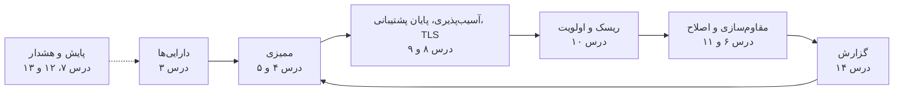

# دورهٔ آموزشی NGCorion

| مورد | مقدار |
|---|---|
| محصول | NGCorion — سامانهٔ ممیزی، مقاوم‌سازی و مدیریت وضعیت امنیتی زیرساخت |
| نسخه | 2.1.2 |
| نسخهٔ سند | 1.1 |
| مخاطب | کارشناسان امنیت و شبکه، سرپرستان تیم امنیت، مدیران سامانه، و هر کسی که تازه با NGCorion کار می‌کند |
| اسناد مرتبط | [معرفی محصول](PRODUCT_OVERVIEW.md)، [راهنمای کاربر](USER_GUIDE.md)، [راهنمای مدیر](ADMIN_GUIDE.md) |

این دوره کار با NGCorion را از اولین ورود تا کار روزانهٔ یک تیم امنیت، گام‌به‌گام و با مثال واقعی آموزش
می‌دهد. همهٔ درس‌ها روی یک **سازمان نمونه** پیش می‌روند تا نتیجهٔ هر درس پایهٔ درس بعد باشد. برای شرح
کامل هر قابلیت به [راهنمای کاربر](USER_GUIDE.md) و [راهنمای مدیر](ADMIN_GUIDE.md) پیوند داده شده است.

---

## فهرست درس‌ها

| درس | موضوع | چه کسی | زمان تقریبی |
|---|---|---|---|
| ۰ | دربارهٔ دوره و سازمان نمونه | همه | ۱۰ دقیقه |
| ۱ | نخستین ورود و آشنایی با رابط | همه | ۲۰ دقیقه |
| ۲ | آماده‌سازی سامانه | مدیر سیستم | ۶۰ دقیقه |
| ۳ | ساخت فهرست دارایی‌ها | کارشناس | ۴۵ دقیقه |
| ۴ | نخستین ممیزی و خواندن نتیجه | کارشناس | ۴۵ دقیقه |
| ۵ | ممیزی گروهی و زمان‌بندی‌شده | کارشناس | ۳۰ دقیقه |
| ۶ | مقاوم‌سازی امن | کارشناس | ۴۵ دقیقه |
| ۷ | پشتیبان پیکربندی دستگاه‌ها و تشخیص تغییر | کارشناس شبکه | ۴۵ دقیقه |
| ۸ | آسیب‌پذیری‌ها (CVE) | کارشناس | ۳۰ دقیقه |
| ۹ | پایان پشتیبانی نرم‌افزارها و گواهی‌های TLS | کارشناس | ۳۰ دقیقه |
| ۱۰ | تحلیل ریسک | کارشناس، سرپرست | ۲۰ دقیقه |
| ۱۱ | پیگیری اصلاح، پذیرش ریسک، سیاست بنچمارک و انطباق | کارشناس، سرپرست | ۶۰ دقیقه |
| ۱۲ | پایش شبکه: SNMP، Syslog، دستگاه‌های ناشناس، توپولوژی و اعتبارسنجی معماری | کارشناس شبکه | ۷۵ دقیقه |
| ۱۳ | هشدارها و اعلان‌ها | مدیر سیستم، سرپرست | ۳۰ دقیقه |
| ۱۴ | گزارش‌ها | همه | ۳۰ دقیقه |
| ۱۵ | جستجوی سراسری | همه | ۱۰ دقیقه |
| ۱۶ | اتصال سامانه‌های دیگر: کلید API و وب‌هوک | مدیر سیستم، برنامه‌نویس | ۳۰ دقیقه |
| ۱۷ | نگهداری سامانه | مدیر سیستم | ۴۵ دقیقه |
| ۱۸ | سناریوهای سرتاسری | همه | ۶۰ دقیقه |
| ۱۹ | عیب‌یابی | همه | مرجع |
| پیوست | برگهٔ یادآور و فهرست کارهای دوره‌ای | همه | مرجع |

---

## درس ۰. دربارهٔ دوره و سازمان نمونه

### ۰.۱ ساختار هر درس

هر درس این بخش‌ها را دارد:

* **هدف:** پس از درس چه کاری از شما برمی‌آید.
* **پیش‌نیاز:** نقش و مجوزی که لازم است و درس‌هایی که باید پیش‌تر انجام شده باشند.
* **گام‌ها:** کار دقیق در رابط، با نام منوها و دکمه‌ها همان‌طور که رابط فارسی نشان می‌دهد.
* **مثال:** همان گام‌ها با مقادیر واقعی سازمان نمونه.
* **نتیجهٔ مورد انتظار:** آنچه باید ببینید تا مطمئن شوید کار درست انجام شده است.
* **نکته‌ها و خطاهای رایج.**
* **تمرین:** کاری که خودتان، بی‌راهنما، انجام می‌دهید.

نشانه‌گذاری: «الف ← ب ← پ» یعنی در منو «الف» را باز کنید، «ب» را بزنید و سپس «پ» را. متن‌هایی که باید
عیناً تایپ کنید `این‌گونه` نوشته شده‌اند.

### ۰.۲ سازمان نمونه

سازمان نمونه یک شرکت خدمات پرداخت با دامنهٔ `corp.example` است. NGCorion روی نشانی
`https://ngcorion.corp.example` (IP: `10.20.9.10`) در شبکهٔ مدیریتی نصب شده است.

**شبکه‌ها:**

| شبکه | کاربرد | ناحیهٔ ریسک |
|---|---|---|
| `10.20.0.0/24` | تجهیزات شبکه | مدیریتی |
| `10.20.1.0/24` | سرورهای لینوکس | داخلی |
| `10.20.2.0/24` | سرورهای ویندوز و دامنه | داخلی |
| `10.20.3.0/24` | مجازی‌سازی | مدیریتی |
| `10.20.5.0/24` | محیط داده‌های کارت (PCI) | محیط کارت |
| `10.20.9.0/24` | ابزارهای امنیت (NGCorion، SIEM) | مدیریتی |

**دارایی‌های اصلی:**

| نام | نوع | سیستم‌عامل / نسخه | IP |
|---|---|---|---|
| `fw-edge` | فایروال | FortiGate، FortiOS 7.2.5 | `10.20.0.1` |
| `core-sw` | سوییچ مرکزی | Cisco IOS XE | `10.20.0.2` |
| `acc-sw-01` | سوییچ دسترسی | Cisco IOS | `10.20.0.3` |
| `web-01` | وب‌سرور | Ubuntu 22.04، NGINX | `10.20.1.10` |
| `web-02` | وب‌سرور قدیمی | Ubuntu 20.04، Apache | `10.20.1.11` |
| `db-01` | پایگاه داده | RHEL 9، MySQL 8 | `10.20.1.20` |
| `dc-01` | کنترل‌کنندهٔ دامنه | Windows Server 2022 | `10.20.2.10` |
| `file-old` | سرور فایل قدیمی | Windows Server 2012 R2 | `10.20.2.30` |
| `esx-01` | میزبان مجازی‌سازی | VMware ESXi 8 | `10.20.3.5` |
| `pay-app` | سرور برنامهٔ پرداخت | Ubuntu 22.04 | `10.20.5.10` |
| `pay-db` | پایگاه دادهٔ پرداخت | Ubuntu 22.04، MongoDB | `10.20.5.20` |

**کاربران:**

| نام کاربری | نقش | کار |
|---|---|---|
| `admin` | مدیر سیستم | حساب اضطراری؛ برای کار روزانه به کار نمی‌رود |
| `n.rahimi` | مدیر سیستم | راهبر NGCorion |
| `s.karimi` | مدیر (manager) | سرپرست تیم امنیت؛ تأیید پذیرش ریسک و سیاست بنچمارک |
| `a.moradi` | کاربر (user) | کارشناس ممیزی و مقاوم‌سازی سرورها |
| `h.jafari` | کاربر (user) | کارشناس شبکه؛ پشتیبان دستگاه‌ها و پایش |
| `ext.auditor` | مهمان (guest) | ممیز بیرونی PCI؛ فقط خواندن |

> **مهم:** همهٔ نام‌ها، نشانی‌ها و رمزهای این دوره ساختگی‌اند. در محیط واقعی، نشانی‌ها و حساب‌های سازمان
> خودتان را به کار ببرید و هیچ رمزی را در سند، تیکت یا پیام ننویسید.

### ۰.۳ چرخهٔ کار با NGCorion



---

## درس ۱. نخستین ورود و آشنایی با رابط

**هدف:** وارد شوید، رمز و ورود دومرحله‌ای را تنظیم کنید و راه خود را در رابط پیدا کنید.

**پیش‌نیاز:** حسابی که مدیر سیستم برایتان ساخته (یا حساب سازمانی، اگر ورود با Active Directory روشن است).

### ۱.۱ ورود و تغییر رمز موقت

1. مرورگر را باز کنید و به `https://ngcorion.corp.example` بروید. اگر مرورگر هشدار گواهی داد، **ادامه
   ندهید** و به مدیر سیستم خبر دهید.
2. اطلاعیهٔ استفادهٔ مجاز را بخوانید؛ ورود یعنی پذیرش آن.
3. نام کاربری (`a.moradi`) و رمز موقتی را که حضوری گرفته‌اید وارد کنید.
4. صفحهٔ «تغییر رمز عبور» باز می‌شود: رمز موقت را در «رمز عبور فعلی» و رمز تازه را دو بار وارد کنید.

**قواعد رمز:** ۸ تا ۷۲ نویسه، دست‌کم یک حرف بزرگ و یک حرف کوچک لاتین، یک رقم و یک نویسهٔ خاص. پیشنهاد:
عبارت عبور بلند، مثل `Saat-Haft-Sobh_Ghahve#14` (این نمونه را به کار نبرید).

### ۱.۲ ورود دومرحله‌ای

1. منوی زیر نام شما (بالای صفحه) ← «ورود دومرحله‌ای» ← «راه‌اندازی ورود دومرحله‌ای».
2. رمز خود را وارد کنید.
3. در برنامهٔ احراز هویت گوشی (Google Authenticator، Microsoft Authenticator یا FreeOTP) کد QR را
   اسکن کنید، کد ۶ رقمی را وارد کنید و «روشن کردن» را بزنید.
4. **۸ کد بازیابی** فقط همین یک بار نمایش داده می‌شوند. آن‌ها را جدا از گوشی نگه دارید (مثلاً در گاوصندوق
   رمز سازمان).

**نتیجهٔ مورد انتظار:** از ورود بعدی، پس از رمز، کد ۶ رقمی خواسته می‌شود.

> برای مدیر سیستم و مدیر، ورود دومرحله‌ای به‌طور پیش‌فرض الزامی است. مدیر سیستم مهلتی ندارد و باید در
> همان ورود اول آن را راه‌اندازی کند.

### ۱.۳ زبان و تاریخ

منوی زیر نام شما ← «زبان». در فارسی صفحه راست‌به‌چپ، اعداد فارسی و تاریخ‌ها شمسی‌اند. فیلدهای تاریخ را
مانند `۱۴۰۵/۰۷/۲۶` بنویسید یا از تقویم کنار فیلد انتخاب کنید.

### ۱.۴ منو

منو به ترتیب کار چیده شده است:

| گروه منو | برای |
|---|---|
| داشبورد، هشدارها | وضعیت کلی و هشدارهای باز |
| دارایی‌ها | فهرست، گروه‌ها، نرم‌افزارها، کشف خودکار، الزامات امنیتی دارایی |
| ارزیابی امنیتی | ریسک، ممیزی، ممیزی گروهی، زمان‌بندی، آسیب‌پذیری‌ها (CVE) |
| اصلاح و مقاوم‌سازی | مقاوم‌سازی، پیگیری اصلاح، ریسک‌های پذیرفته‌شده، سیاست بنچمارک‌ها، انطباق |
| پشتیبان دستگاه‌ها | پشتیبان‌های پیکربندی و تاریخچهٔ بازیابی |
| شبکه و پایش | NOC، میزبان‌ها، دستگاه‌های ناشناس، Syslog، توپولوژی |
| گزارش‌ها | ساخت، بایگانی، زمان‌بندی |
| مدیریت سامانه | کاربران، پیکربندی، قواعد هشدار، پایگاه دادهٔ آسیب‌پذیری، لایسنس، پشتیبان NGCorion، لاگ‌ها |

* هر کس فقط بخش‌هایی را می‌بیند که مجوزشان را دارد. اگر منویی را نمی‌بینید، احتمالاً مجوزش را ندارید.
* با دکمهٔ کنار لوگو منو جمع می‌شود و فقط آیکن گروه‌ها می‌ماند.
* هر ردیف منو پیوند است: با Ctrl+کلیک در سربرگ تازه باز می‌شود.

### ۱.۵ جستجو و زنگ هشدار

* کلید `/` یا Ctrl+K کادر جستجوی بالای صفحه را باز می‌کند (درس ۱۵).
* **زنگ** کنار نام شما تعداد هشدارهای باز را نشان می‌دهد (درس ۱۳).
* **دکمهٔ «؟»** کنار زنگ (یا کلید `?`) راهنمای همان صفحه را باز می‌کند: کارهای اصلی گام‌به‌گام، مثال،
  خطاهای رایج و پیوند به صفحه‌های مرتبط. هر جا در این دوره گیر کردید، اول آن را بزنید.

### ۱.۶ پایان کار

منوی زیر نام شما ← «خروج». سامانه پس از ۳۰ دقیقه بی‌کاری هم خودبه‌خود خارج می‌شود و هر نشست حداکثر
۱۲۰ دقیقه است.

**خطاهای رایج:**

| وضعیت | علت و راه |
|---|---|
| ورود تا ۱۵ دقیقه پذیرفته نمی‌شود | ۵ تلاش ناموفق از یک نشانی یا ۱۰ تلاش برای یک نام کاربری در ۱۵ دقیقه. صبر کنید؛ اگر تلاش‌ها از شما نبوده، گزارش دهید. |
| کد ۶ رقمی پذیرفته نمی‌شود | ساعت گوشی را روی «خودکار» بگذارید. کد نادرست هم تلاش ناموفق شمرده می‌شود. |
| گوشی گم شده است | در صفحهٔ کد، «گوشی را گم کرده‌اید؟ از کد بازیابی استفاده کنید». اگر کدها هم نیست، مدیر سیستم پس از تأیید هویت شما آن را بازنشانی می‌کند. |

**تمرین ۱:** وارد شوید، ورود دومرحله‌ای را راه‌اندازی کنید، زبان را یک بار انگلیسی و دوباره فارسی کنید،
منو را جمع و باز کنید، با `/` صفحهٔ «داشبورد» را جستجو کنید و راهنمای آن را با «؟» باز کنید.

---

## درس ۲. آماده‌سازی سامانه (مدیر سیستم)

**هدف:** NGCorion را پس از نصب برای استفادهٔ عملیاتی آماده کنید.

**پیش‌نیاز:** نقش مدیر سیستم. نصب ماشین مجازی و راه‌اندازی اول (راهنمای مدیر، بخش ۴) انجام شده است.

ترتیب پیشنهادی همان فهرست بررسی راهنمای مدیر (بند ۵.۱) است:

| # | کار | کجا |
|---|---|---|
| ۱ | رمز موقت `admin` و ورود دومرحله‌ای | اولین ورود (اجباری) |
| ۲ | لایسنس | مدیریت سامانه ← لایسنس |
| ۳ | گواهی TLS سازمان | پیکربندی سیستم ← تنظیمات گواهی |
| ۴ | زمان و NTP | پیکربندی سیستم ← تنظیمات زمان |
| ۵ | سرور ایمیل | پیکربندی سیستم ← تنظیمات SMTP |
| ۶ | پشتیبان خودکار NGCorion | مدیریت سامانه ← پشتیبان‌گیری از NGCorion |
| ۷ | حساب‌های شخصی و مجوزها | مدیریت سامانه ← کاربران |
| ۸ | ورود با Active Directory (اختیاری) | پیکربندی سیستم ← Active Directory / LDAP |
| ۹ | پروفایل‌های اعتبارنامه | پیکربندی سیستم ← پروفایل‌های اعتبارنامه |
| ۱۰ | پایگاه دادهٔ CVE | مدیریت سامانه ← پایگاه دادهٔ آسیب‌پذیری |

### ۲.۱ لایسنس

1. «مدیریت سامانه ← لایسنس».
2. کلید لایسنس را وارد و «فعال‌سازی» را بزنید.
3. **بدون اینترنت:** «فعال‌سازی آفلاین» ← کلید ← «دریافت فایل درخواست» (`.ngcreq`). فایل را از مسیر مجاز
   سازمان برای مدیر لایسنس بفرستید و فایل امضاشدهٔ برگشتی (`.ngclic`) را با «بارگذاری فایل لایسنس» نصب کنید.

**نتیجهٔ مورد انتظار:** طرح لایسنس، سقف دارایی‌ها و تاریخ انقضا نمایش داده می‌شود.

> اگر سرور لایسنس ۴۸ ساعت در دسترس نباشد، سامانه تا ۳۰ روز با لایسنس پایلوت (۵ دارایی) کار می‌کند. هشدار
> «مشکل لایسنس» را در درس ۱۳ برای خودتان فعال کنید.

### ۲.۲ گواهی TLS رابط وب

1. از CA سازمان برای نام `ngcorion.corp.example` گواهی بگیرید.
2. «مدیریت سامانه ← پیکربندی سیستم ← تنظیمات گواهی»: گواهی و کلید (PEM) یا فایل `.pfx` را با رمزش
   بارگذاری کنید.

**نتیجهٔ مورد انتظار:** صادرکننده، دارنده و تاریخ انقضا نمایش داده می‌شود و مرورگر دیگر هشدار نمی‌دهد.

### ۲.۳ زمان، NTP و ایمیل

1. «تنظیمات زمان»: منطقهٔ زمانی `Asia/Tehran` و سرور NTP سازمان (در مثال `10.20.2.10`). ساعت درست برای
   ورود دومرحله‌ای، زمان‌بندی‌ها و دنبالهٔ ممیزی ضروری است.
2. «تنظیمات SMTP»: سرور `mail.corp.example`، پورت `587` با STARTTLS، حساب `ngcorion@corp.example`.
3. «ارسال ایمیل آزمایشی» را به ایمیل خودتان بزنید.

**نتیجهٔ مورد انتظار:** ایمیل آزمایشی می‌رسد. بدون SMTP، بازیابی رمز با ایمیل، اعلان‌های ایمیلی و ارسال
گزارش‌های زمان‌بندی‌شده کار نمی‌کند.

### ۲.۴ پشتیبان خودکار NGCorion

1. «مدیریت سامانه ← پشتیبان‌گیری از NGCorion».
2. **رمز پشتیبان** قوی تعیین کنید و آن را **جدا از سرور** در گاوصندوق رمز سازمان نگه دارید. بدون این رمز
   هیچ پشتیبانی قابل بازیابی نیست.
3. مقصد SFTP بیرون از سرور تعریف کنید (مثلاً `backup.corp.example`، پوشهٔ `/ngcorion`). کلید میزبان
   SFTP در اولین اتصال پین می‌شود.
4. پشتیبان خودکار را روشن کنید: هر شب ساعت ۰۱:۰۰، ۱۴ نسخه.
5. یک پشتیبان دستی بگیرید و روی آن **«آزمون بازیابی»** را اجرا کنید.

**نتیجهٔ مورد انتظار:** آزمون بازیابی موفق است و سامانهٔ فعال تغییری نکرده است.

### ۲.۵ کاربران و مجوزها

1. «مدیریت سامانه ← کاربران» ← «افزودن کاربر».
2. نام کاربری، ایمیل، شمارهٔ موبایل (برای هشدار پیامکی)، نقش و رمز موقت.
3. برای نقش‌های غیر از مدیر سیستم، برای هر ماژول «خواندن»، «نوشتن» و «حذف» را جدا تعیین کنید.

**مثال: مجوزهای سازمان نمونه**

| ماژول | `s.karimi` (مدیر) | `a.moradi` (کاربر) | `h.jafari` (کاربر) | `ext.auditor` (مهمان) |
|---|---|---|---|---|
| داشبورد | خواندن | خواندن | خواندن | خواندن |
| فهرست دارایی‌ها | خواندن، نوشتن | خواندن، نوشتن | خواندن، نوشتن | خواندن |
| ممیزی | خواندن، نوشتن | خواندن، نوشتن | خواندن | خواندن |
| مقاوم‌سازی | خواندن، نوشتن | خواندن، نوشتن | — | — |
| CVE | خواندن، نوشتن | خواندن، نوشتن | خواندن | خواندن |
| پیگیری اصلاح | خواندن، نوشتن | خواندن، نوشتن | خواندن، نوشتن | خواندن |
| پشتیبان‌گیری و بازیابی | خواندن، نوشتن | — | خواندن، نوشتن | — |
| NOC، توپولوژی | خواندن | خواندن | خواندن، نوشتن | — |
| گزارش‌ها | خواندن، نوشتن | خواندن، نوشتن | خواندن، نوشتن | خواندن |
| استفاده از پروفایل‌های اعتبارنامه | خواندن | خواندن | خواندن | — |

> **اصل کمترین دسترسی:** فقط آنچه برای کار هر شخص لازم است بدهید. مجوز «حذف» را جز در موارد لازم ندهید.
> برای ممیز بیرونی همیشه نقش مهمان و فقط برای مدت ممیزی؛ پس از آن حساب را غیرفعال کنید.

**نتیجهٔ مورد انتظار:** هر کاربر در اولین ورود باید رمز موقت را عوض کند.

### ۲.۶ ورود با Active Directory (اختیاری)

«مدیریت سامانه ← پیکربندی سیستم ← Active Directory / LDAP»:

| فیلد | مقدار نمونه |
|---|---|
| نوع | Active Directory |
| سرورها | `dc-01.corp.example` |
| رمزنگاری | LDAPS (پورت ۶۳۶) |
| Base DN | `DC=corp,DC=example` |
| حساب سرویس فقط‌خواندنی | `CN=svc-ngc-ldap,OU=Service,DC=corp,DC=example` |
| گواهی CA دامنه | فایل PEM گواهی ریشهٔ AD CS |

1. «آزمون اتصال».
2. **نگاشت گروه‌ها:** «جستجوی گروه‌ها» و افزودن:

    | گروه دامنه | نقش در NGCorion |
    |---|---|
    | `NGC-Admins` | مدیر سیستم |
    | `NGC-SecLeads` | مدیر، با مجوزهای ستون `s.karimi` |
    | `NGC-Auditors` | کاربر، با مجوزهای ستون `a.moradi` |
    | `NGC-Viewers` | مهمان |

3. «آزمون ورود یک کاربر» برای یک عضو هر گروه.
4. «ورود با دایرکتوری سازمان» را روشن و ذخیره کنید.

**نتیجهٔ مورد انتظار:** کاربران با نام و رمز ویندوز وارد می‌شوند؛ کسی که در هیچ گروه نگاشت‌شده‌ای نیست
وارد نمی‌شود؛ کاربری که در دامنه غیرفعال شود حداکثر تا ۱۵ دقیقه بعد دسترسی‌اش قطع می‌شود.

> حساب `admin` و مدیران محلی همیشه کار می‌کنند تا اگر دامنه در دسترس نبود سامانه قفل نشود؛ هر ورود آن‌ها
> هشدار «ورود مدیر محلی» می‌دهد.

### ۲.۷ پروفایل‌های اعتبارنامه

پروفایل، اطلاعات ورود به دستگاه‌ها برای کارهای گروهی و زمان‌بندی‌شده است. **فقط‌نوشتنی** است: پس از
ذخیره، هیچ صفحه‌ای رمز را نشان نمی‌دهد.

ابتدا روی دستگاه‌ها حساب جداگانهٔ ممیزی با کمترین دسترسی لازم بسازید، نه حساب مدیر مشترک. سپس
«مدیریت سامانه ← پیکربندی سیستم ← پروفایل‌های اعتبارنامه» ← پروفایل تازه:

| نام پروفایل | نوع | حساب دستگاه | برای |
|---|---|---|---|
| `linux-audit` | SSH | `ngc-audit` با رمز sudo | Ubuntu، RHEL، NGINX، Apache، MySQL، MongoDB |
| `netdev-ssh` | SSH | `ngc-audit` با Enable secret | Cisco، FortiGate (ممیزی و پشتیبان‌گیری) |
| `win-domain` | WinRM | `CORP\svc-ngc-audit`، روش Kerberos | Windows Server، AD، DNS، DHCP، IIS |

1. برای هر پروفایل «دورهٔ تعویض گذرواژه» را ۹۰ روز بگذارید.
2. «آزمودن ورود روی یک دارایی»: `linux-audit` روی `web-01`، `netdev-ssh` روی `core-sw`، `win-domain` روی
   `dc-01`.

**نتیجهٔ مورد انتظار:** هر آزمون «ورود موفق». آزمون فقط وارد می‌شود و چیزی را تغییر نمی‌دهد.

### ۲.۸ پایگاه دادهٔ CVE

«مدیریت سامانه ← پایگاه دادهٔ آسیب‌پذیری»:

* **با اینترنت:** «دانلود از اینترنت» از NVD. کلید API سرویس NVD سرعت را بسیار بالا می‌برد. «زمان
  به‌روزرسانی خودکار» را روی ساعتی کم‌کار (مثلاً ۰۳:۳۰) بگذارید.
* **شبکهٔ بسته:** روی یک NGCorion دارای اینترنت «ساخت بستهٔ به‌روزرسانی»؛ کلید عمومی آن را با «کپی کلید
  عمومی» بردارید، روی سرور بسته به کلیدهای مورد اعتماد بیفزایید و اثر انگشت را از راه مستقل تطبیق دهید؛
  سپس «وارد کردن بسته».

**نتیجهٔ مورد انتظار:** وضعیت پایگاه داده تاریخ آخرین به‌روزرسانی را نشان می‌دهد.

**تمرین ۲:** یک حساب مهمان برای `ext.auditor` بسازید و با آن وارد شوید؛ بررسی کنید منوهای «مقاوم‌سازی» و
«مدیریت سامانه» دیده نمی‌شوند. سپس حساب را غیرفعال کنید.

---

## درس ۳. ساخت فهرست دارایی‌ها

**هدف:** همهٔ دارایی‌ها را با اطلاعات درست ثبت کنید و آن‌ها را برچسب و گروه‌بندی کنید.

**پیش‌نیاز:** مجوز نوشتن «فهرست دارایی‌ها» و «الزامات دارایی»؛ برای کشف خودکار، مجوز «کشف خودکار».

> چرا مهم است: هر ماژول دیگر بر پایهٔ فهرست دارایی‌هاست. Syslog فقط از دارایی‌های ثبت‌شده پذیرفته
> می‌شود، ریسک از ناحیه و اهمیت دارایی حساب می‌شود و گروه‌ها از روی مشخصات دارایی ساخته می‌شوند.

### ۳.۱ اطلاعات پایه

«دارایی‌ها ← الزامات امنیتی دارایی». پیش از ثبت دارایی‌ها این فهرست‌ها را پر کنید:

| فهرست | مقادیر نمونه |
|---|---|
| مکان‌ها | سایت `تهران-مرکزی`، طبقهٔ `۳`، اتاق `اتاق سرور`، رک `A2` |
| مالکان | `واحد شبکه`، `واحد زیرساخت`، `تیم پرداخت` |
| انواع دارایی | `فایروال`، `سوییچ`، `سرور فیزیکی`، `سرور مجازی` (نوع اجرا: مجازی)، `میزبان مجازی‌سازی` |
| ناحیه‌های شبکه | `مدیریتی`، `داخلی`، `DMZ`، `محیط کارت` |
| سازندگان | Cisco، Fortinet، Dell، VMware |
| سیستم‌عامل‌ها | Ubuntu 22.04، RHEL 9، Windows Server 2022، FortiOS 7.2 |

**ناحیه‌ها** یک فهرست برای همهٔ برنامه‌اند: همین ناحیه‌ها در ریسک، گروه‌ها، هشدارها و گزارش‌ها به کار می‌روند.
برای هر ناحیه دو چیز را تعیین کنید:

| ناحیه | امتیاز در معرض بودن (ریسک) | جایگاه در شبکه (Cisco SAFE) |
|---|---|---|
| `مدیریتی` | ۳۰ | شبکهٔ مدیریت |
| `داخلی` | ۴۰ | مرکز داده |
| `DMZ` | ۷۰ | لبه (DMZ) |
| `محیط کارت` | ۶۰ | مرکز داده |

جایگاه در شبکه را برای ناحیه‌هایی که نام فارسی دارند حتماً انتخاب کنید؛ سامانه جایگاه را فقط از نام‌های
انگلیسی رایج (مثل «DMZ» یا «Guest») حدس می‌زند و اعتبارسنجی معماری (درس ۱۲.۶) دارایی ناحیهٔ بی‌جایگاه را
«جایگاه در شبکه نامعلوم» گزارش می‌کند. امتیاز ناحیه را هم بدهید: ناحیهٔ بی‌امتیاز امتیاز دارایی بدون ناحیه
را می‌گیرد. «نوع اجرا»ی هر نوع دارایی (فیزیکی یا مجازی) تعیین می‌کند کدام دارایی‌ها میزبان لازم دارند.

### ۳.۲ افزودن دستی یک دارایی

1. «دارایی‌ها ← فهرست دارایی‌ها» ← «افزودن».
2. **مثال: `pay-app`**

    | فیلد | مقدار |
    |---|---|
    | نام | `pay-app` |
    | نام میزبان | `pay-app.corp.example` |
    | نشانی IP | `10.20.5.10` |
    | نوع | سرور مجازی |
    | سیستم‌عامل | Ubuntu 22.04 |
    | مکان | تهران-مرکزی / ۳ / اتاق سرور / A2 |
    | مالک | تیم پرداخت |
    | ناحیه | محیط کارت |
    | سطح محرمانگی و اهمیت | بالا |
    | میزبان | `esx-01` (نوع مجازی است؛ فقط دارایی‌های فیزیکی پیشنهاد می‌شوند) |

3. ذخیره.

**نتیجهٔ مورد انتظار:** `pay-app` در فهرست است و در صفحهٔ `esx-01` میان ماشین‌های مجازی دیده می‌شود. تاریخ
آخرین ممیزی و مقاوم‌سازی را وارد نکنید؛ پس از اولین ممیزی (درس ۴) و مقاوم‌سازی (درس ۶) خودکار پر می‌شوند.

**نشانی مشترک و نشانی‌های دیگر:**

* اگر برای دارایی تازه‌ای نشانی `10.20.5.10` را تایپ کنید، فرم زیر فیلد می‌گوید این نشانی IP `pay-app` هم هست.
  ثبت ممکن است (مثلاً دو سرویس پشت یک NAT)، ولی Syslog و دستگاه‌های دیده‌شده از این نشانی فقط به یکی از آن‌ها
  نسبت داده می‌شوند؛ اگر اشتباه تایپی است، اصلاحش کنید.
* `fw-edge` پیام‌های Syslog و SNMP را از اینترفیس مدیریت `10.20.9.1` می‌فرستد، نه `10.20.0.1`. در ویرایش «شبکه و
  سیستم» آن، `10.20.9.1` را در «نشانی‌های دیگر» بیفزایید (برای Syslog) و در صفحهٔ میزبان NOC همین نشانی را
  «نشانی SNMP» کنید (درس ۱۲).

### ۳.۳ ورود گروهی از Excel

1. در «فهرست دارایی‌ها» الگوی فایل Excel را دریافت کنید.
2. هر دارایی را در یک ردیف بنویسید (ستون‌ها همان ستون‌های الگو هستند). در مثال، ده دارایی جدول درس ۰ را
   وارد کنید.
3. فایل را بارگذاری کنید.

**نتیجهٔ مورد انتظار:** ردیف‌های درست ثبت می‌شوند و ردیف‌های نادرست با دلیل گزارش می‌شوند (مثلاً نشانی IP
نادرست یا مکانی که در اطلاعات پایه نیست). ردیف‌های نادرست را اصلاح و فقط همان‌ها را دوباره بارگذاری کنید.

### ۳.۴ کشف خودکار

1. «دارایی‌ها ← کشف خودکار».
2. هدف: `10.20.1.0/24`؛ نوع اسکن: «پورت‌های شناخته‌شده».
3. پس از پایان، فهرست میزبان‌ها با پورت‌ها و سرویس‌ها نمایش داده می‌شود.
4. برای میزبانی که دارایی نیست (مثلاً `10.20.1.35` با پورت‌های 22 و 443) «ثبت به‌عنوان دارایی تازه»؛ برای
   دارایی موجود، اطلاعات پورت‌ها را روی همان دارایی اعمال کنید.
5. «کشف زمان‌بندی‌شده»: همین اسکن را هفتگی، جمعه ساعت ۰۲:۰۰ تکرار کنید.

> فقط شبکه‌هایی را اسکن کنید که اجازهٔ اسکن آن‌ها را دارید. پیش از اسکن شبکهٔ محیط کارت با تیم پرداخت
> هماهنگ کنید.

### ۳.۵ برچسب و تغییر گروهی

1. در «فهرست دارایی‌ها» کادر کنار `pay-app` و `pay-db` را بزنید.
2. در نوار بالای جدول «افزودن برچسب»: `pci`.
3. همین‌طور برای `web-01` و `web-02` برچسب `web`.

**نتیجهٔ مورد انتظار:** برچسب زیر نام دارایی دیده می‌شود و جستجوی `pci` در «فهرست دارایی‌ها» هر دو را پیدا می‌کند. هر تغییر در
تاریخچهٔ همان دارایی ثبت می‌شود.

### ۳.۶ گروه‌های دارایی

«دارایی‌ها ← گروه‌های دارایی» ← «گروه تازه». گروه‌های سازمان نمونه:

| نام گروه | نوع | شرط یا اعضا |
|---|---|---|
| `محیط کارت` | پویا | بازهٔ IP `10.20.5.0/24` |
| `سرورهای لینوکس` | پویا | نوع: سرور؛ سیستم‌عامل: Ubuntu یا RHEL |
| `تجهیزات Cisco` | پویا | سازنده: Cisco |
| `فایروال‌ها` | پویا | نوع: فایروال |
| `سرورهای ویندوز` | پویا | سیستم‌عامل: Windows Server |
| `پایلوت مقاوم‌سازی` | ثابت | `web-01`، `web-02` |

هنگام نوشتن شرط‌ها، دارایی‌هایی که اکنون با شرط جورند نمایش داده می‌شوند؛ پیش از ذخیره آن را بررسی کنید.

**نتیجهٔ مورد انتظار:** هر دارایی تازه‌ای که در `10.20.5.0/24` ثبت شود، خودبه‌خود عضو گروه `محیط کارت` است.

> گروه‌ها در ممیزی گروهی، پشتیبان‌گیری زمان‌بندی‌شده، سیاست بنچمارک، انطباق و گزارش‌ها به کار می‌روند.
> گروهی که یک زمان‌بندی از آن استفاده می‌کند حذف نمی‌شود.

### ۳.۷ صفحهٔ دارایی (نمای ۳۶۰ درجه)

روی نام `pay-app` بزنید. این صفحه همه‌چیز دربارهٔ دارایی را یک‌جا دارد: ریسک، انطباق، آسیب‌پذیری‌ها،
موارد اصلاح، پشتیبان‌ها، پایش، نرم‌افزارها و **روند اجرا** (خط زمانی همهٔ اتفاق‌ها). در درس‌های بعد پس از
هر کار به این صفحه برگردید و تغییرش را ببینید.

**خطاهای رایج:**

| وضعیت | علت و راه |
|---|---|
| «سقف دارایی لایسنس» | تعداد دارایی‌ها به سقف لایسنس رسیده است. دارایی‌های بی‌استفاده را حذف کنید یا لایسنس را ارتقا دهید. |
| دارایی «خارج از لایسنس» | ممیزی و مقاوم‌سازی روی این دارایی اجرا نمی‌شود. |
| Syslog یک دستگاه نمی‌رسد | نشانی IP دارایی با نشانی‌ای که دستگاه از آن پیام می‌فرستد یکی نیست. |

**تمرین ۳:** دارایی `esx-01` را دستی ثبت کنید، گروه پویای `میزبان‌های مجازی‌سازی` را با شرط بازهٔ
`10.20.3.0/24` بسازید و ببینید `esx-01` در آن است.

---

## درس ۴. نخستین ممیزی و خواندن نتیجه

**هدف:** یک سرور لینوکس، یک فایروال و یک کنترل‌کنندهٔ دامنه را ممیزی کنید و نتیجه را درست بخوانید.

**پیش‌نیاز:** مجوز نوشتن «ممیزی»؛ دارایی‌ها ثبت شده‌اند (درس ۳)؛ حساب ممیزی روی دستگاه‌ها ساخته شده است.

> ممیزی **فقط می‌خواند** و چیزی را روی دستگاه تغییر نمی‌دهد. اطلاعات ورود ممیزی تکی فقط در طول همان اجرا به
> کار می‌رود و ذخیره نمی‌شود.

### ۴.۱ ممیزی سرور لینوکس (`web-01`)

1. «ارزیابی امنیتی ← اجرای ممیزی» ← «ممیزی جدید».
2. دارایی: `web-01`. نوع دستگاه از روی دارایی Linux پیشنهاد می‌شود.
3. اطلاعات ورود: نام کاربری `ngc-audit`، رمز، پورت `22`، رمز Sudo.
4. «اجرا». ممیزی چند دقیقه طول می‌کشد.

**نتیجهٔ مورد انتظار (نمونه):**

| مورد | مقدار نمونه |
|---|---|
| امتیاز انطباق | ۶۲٪ |
| بررسی‌ها | موفق، ناموفق و دستی، هر کدام با تعداد |
| نمونهٔ یک کنترل ناموفق | `5.2.10` — SSH PermitRootLogin؛ شدت: بالا؛ شاهد: `PermitRootLogin: yes`؛ توصیه: `Set PermitRootLogin no in /etc/ssh/sshd_config` |

### ۴.۲ خواندن نتیجه

* **امتیاز انطباق:** سهم کنترل‌های موفق. کنترل‌های «دستی» و «اطلاعاتی» در امتیاز نیستند.
* **شاهد:** دقیقاً آنچه از دستگاه خوانده شد. پیش از هر تصمیم، شاهد را بخوانید؛ اگر با واقعیت دستگاه نمی‌خواند،
  با پشتیبانی تماس بگیرید.
* **دستی:** کنترل‌هایی که خودکار سنجیده نمی‌شوند (مثلاً «آیا سیاست مکتوب وجود دارد؟»). شاهد را بخوانید و خودتان
  تصمیم بگیرید.
* **تقریبی:** بررسی‌هایی که نتیجهٔ خودکارشان باید دستی تأیید شود.
* **گزارش این ممیزی:** PDF با شاهد هر کنترل، برای ممیز.
* **رفتن به مقاوم‌سازی برای اصلاح بخش‌های ناموفق:** درس ۶.

### ۴.۳ ممیزی فایروال (`fw-edge`)

1. «ممیزی جدید» ← دارایی `fw-edge` ← نوع FortiGate.
2. نام کاربری و رمز SSH حساب `ngc-audit`.
3. «شناسایی VDOMها» را بزنید و «همهٔ VDOMها» را انتخاب کنید.
4. «اجرا».

**نمونهٔ کنترل ناموفق:** قفل نشدن حساب مدیر پس از ورود ناموفق؛ شاهد از `get system global`:
`admin-lockout-threshold` غیرفعال؛ توصیه:

```
config system global
 set admin-lockout-threshold 3
 set admin-lockout-duration 60
end
```

### ۴.۴ ممیزی کنترل‌کنندهٔ دامنه (`dc-01`)

1. «ممیزی جدید» ← `dc-01` ← نوع Windows Server.
2. نام کاربری `CORP\svc-ngc-audit`، رمز، پورت WinRM (`5986` برای HTTPS)، روش انتقال Kerberos.
3. «نقش سرور»: کنترل‌کنندهٔ دامنه.
4. «اجرا».
5. سپس ممیزی جداگانه با نوع **Active Directory** روی همان دارایی، و در صورت نیاز **Windows DNS Server**.

### ۴.۵ اولین اتصال و پین کلید

در اولین اتصال SSH به هر دستگاه، کلید میزبان آن ثبت (پین) می‌شود. اگر بعداً کلید تغییر کند، اتصال **پیش از
فرستادن هر رمزی** رد می‌شود. این یعنی دستگاه دوباره نصب شده یا کسی خود را جای آن جا زده است. در این حالت
اتصال را تکرار نکنید؛ تغییر را با مالک دستگاه تأیید و به مدیر سیستم گزارش دهید.

**خطاهای رایج:**

| پیام یا وضعیت | علت | راه |
|---|---|---|
| «ممیزی ناموفق بود» | اتصال یا ورود ممکن نشد | نشانی، پورت، نام کاربری، رمز و فایروال میان راه را بررسی کنید. |
| بسیاری از کنترل‌ها خطا یا نامشخص‌اند | رمز sudo داده نشده یا حساب دسترسی کافی ندارد | رمز Sudo را وارد کنید؛ حساب ممیزی باید بتواند فایل‌های پیکربندی را بخواند. |
| WinRM وصل نمی‌شود | WinRM روشن نیست یا روش انتقال اشتباه است | روی سرور `winrm quickconfig` (یا GPO سازمان) و روش انتقال درست. |
| ESXi وصل نمی‌شود | سرویس SSH خاموش است | سرویس SSH را در طول ممیزی روشن و پس از آن خاموش کنید. |

**تمرین ۴:** `db-01` را دو بار ممیزی کنید: یک بار نوع Linux و یک بار نوع MySQL. در صفحهٔ `db-01` ببینید هر
دو ممیزی در بخش «ممیزی‌ها» آمده‌اند.

---

## درس ۵. ممیزی گروهی و زمان‌بندی‌شده

**هدف:** ده‌ها دارایی را با یک کار ممیزی کنید و ممیزی را منظم تکرار کنید.

**پیش‌نیاز:** مجوز نوشتن «ممیزی» و مجوز «استفاده از پروفایل‌های اعتبارنامه»؛ گروه‌ها (درس ۳.۶) و
پروفایل‌ها (درس ۲.۷).

### ۵.۱ ممیزی گروهی

1. «ارزیابی امنیتی ← ممیزی‌های گروهی» ← «شروع ممیزی گروهی».
2. گروه: `سرورهای لینوکس`؛ فناوری: Linux؛ سطح بنچمارک: L1؛ پروفایل اعتبارنامه: `linux-audit`؛ هم‌زمان: `۱۰`.
3. «شروع».

**نتیجهٔ مورد انتظار:** برای هر دارایی یک ممیزی معمولی ساخته می‌شود؛ ستون «انطباق» به نشست آن می‌رود.
دارایی‌هایی که ممیزی نشدند با دلیل فهرست می‌شوند:

| دلیل | معنی و راه |
|---|---|
| ورود رد شد | حساب `ngc-audit` یا رمز sudo روی این دستگاه نیست یا فرق دارد. |
| خارج از دسترس | فایروال، سرور خاموش یا پورت SSH متفاوت. |
| خارج از پوشش مجوز | دارایی بیرون از سقف لایسنس است. |
| بدون نشانی IP | نشانی IP دارایی را ثبت کنید. |
| خطا | جزئیات خطا را بخوانید. |

پس از رفع مشکل‌ها «تلاش دوباره برای n مورد ناموفق» فقط همان‌ها را دوباره ممیزی می‌کند. «توقف» دارایی‌هایی
را که شروع نشده‌اند لغو می‌کند.

### ۵.۲ ممیزی زمان‌بندی‌شده

1. «ارزیابی امنیتی ← زمان‌بندی ممیزی» ← «زمان‌بندی جدید».
2. «چه چیزی ممیزی شود»: «یک گروه دارایی، با پروفایل اعتبارنامه».
3. گروه `سرورهای لینوکس`، فناوری Linux، پروفایل `linux-audit`.
4. تکرار: هفتگی، پنجشنبه ساعت ۲۲:۰۰.
5. ذخیره.

دو زمان‌بندی دیگر برای سازمان نمونه: `تجهیزات Cisco` با `netdev-ssh` و `سرورهای ویندوز` با `win-domain`.

**نتیجهٔ مورد انتظار:** «تاریخچهٔ اجرا» نتیجهٔ هر اجرا را نشان می‌دهد. هر اجرا همهٔ دارایی‌هایی را که در آن
لحظه عضو گروه‌اند ممیزی می‌کند؛ سرور تازه‌ای که اضافه شود، خودبه‌خود در اجرای بعد است.

> زمان‌بندی‌ای که برای یک دارایی تکی با اطلاعات ورود مستقیم ساخته شود، اطلاعات ورود را رمزنگاری‌شده نگه
> می‌دارد. روش گروه و پروفایل را ترجیح دهید: هیچ رمزی در خود زمان‌بندی نیست و تعویض رمز فقط در یک پروفایل
> انجام می‌شود.

**تمرین ۵:** یک ممیزی گروهی برای گروه `فایروال‌ها` با پروفایل `netdev-ssh` اجرا کنید. اگر هشدار
«ممیزی گروهی با خطا پایان یافت» آمد، دلیل را پیدا و رفع کنید و «تلاش دوباره» بزنید.

---

## درس ۶. مقاوم‌سازی امن

**هدف:** کنترل‌های ناموفق را با پیش‌نمایش، پشتیبان و راستی‌آزمایی روی دستگاه اصلاح کنید.

**پیش‌نیاز:** مجوز نوشتن «مقاوم‌سازی»؛ ممیزی `web-01` و `fw-edge` (درس ۴)؛ **مجوز تغییر سازمان** (مثلاً
درخواست تغییر تأییدشده).

> مقاوم‌سازی پیکربندی دستگاه را **تغییر می‌دهد**. پیش از هر اجرا: پیش‌نمایش را بخوانید، پشتیبان بگیرید و راه
> دسترسی جایگزین (کنسول) داشته باشید.

### ۶.۱ اصلاح یک کنترل روی `web-01`

1. «اصلاح و مقاوم‌سازی ← اجرای مقاوم‌سازی» ← نشست ممیزی `web-01` (یا در نتیجهٔ ممیزی «رفتن به مقاوم‌سازی برای
   اصلاح بخش‌های ناموفق»).
2. «انتخاب موارد مقاوم‌سازی»: `5.2.10 SSH PermitRootLogin` را علامت بزنید.
3. **پیش‌نمایش دستورها:** دستورهای دقیق بدون اتصال به دستگاه نمایش داده می‌شوند. بخوانید: فایل
   `sshd_config` چه تغییری می‌کند و آیا سرویس SSH دوباره بارگذاری می‌شود.
4. **«ابتدا از پیکربندی دستگاه پشتیبان بگیر»** را روشن کنید.
5. اطلاعات ورود را وارد و «اجرای اصلاح» را بزنید.

**نتیجهٔ مورد انتظار:** وضعیت «تأییدشده»: دستورها بی‌خطا اجرا شدند **و** دستور راستی‌آزمایی تغییر را تأیید
کرد. خروجی دستورها در «دستورهای اجراشده» است.

6. `web-01` را **دوباره ممیزی کنید.** کنترل `5.2.10` حالا موفق است و امتیاز بالا رفته است.

### ۶.۲ پارامترها

برخی کنترل‌ها مقدار لازم دارند، مثل طول رمز یا نشانی سرور Syslog. مقدارها اعتبارسنجی می‌شوند: عدد در بازهٔ
مجاز، گزینه از فهرست، و متن بدون نویسه‌های خطرناک پوسته.

**مثال روی `fw-edge`:** کنترل قفل حساب مدیر. پارامترها: آستانه `۳` و مدت قفل `۶۰` ثانیه. پیش‌نمایش:

```
config system global
 set admin-lockout-threshold 3
 set admin-lockout-duration 60
end
```

### ۶.۳ مقاوم‌سازی همه

«مقاوم‌سازی همهٔ بررسی‌های ناموفق» همهٔ موارد قابل اصلاح یک نشست را در یک اتصال و با همان قواعد اجرا
می‌کند. روش پیشنهادی برای سازمان نمونه:

1. ابتدا روی گروه `پایلوت مقاوم‌سازی` (`web-01`، `web-02`) و در ساعت کم‌کار.
2. یک هفته پایش: آیا سرویس‌ها درست کار می‌کنند؟
3. سپس دیگر سرورهای لینوکس، **تک‌تک یا در گروه‌های کوچک**؛ برای تجهیزات حیاتی (`fw-edge`، `core-sw`) کنترل‌ها
   را یکی‌یکی اجرا کنید.

### ۶.۴ کنترل‌های بدون اصلاح خودکار

مواردی که «نیاز به اصلاح دستی» دارند (مثلاً تنظیماتی که در ویندوز فقط با GPO اعمال می‌شوند) دستورشان فقط برای
کپی نمایش داده می‌شود. آن‌ها را به مسئول GPO بسپارید و در پیگیری اصلاح (درس ۱۱) دنبال کنید.

**خطاهای رایج:**

| وضعیت | علت و راه |
|---|---|
| «تأیید نشد» | دستور اجرا شد اما راستی‌آزمایی تغییر را ندید. خروجی دستورها را بخوانید؛ در صورت نیاز از پشتیبان بازیابی کنید (درس ۷.۴). |
| پس از اصلاح، دسترسی SSH قطع شد | تنظیمی مثل محدود کردن SSH دسترسی را بسته است. از کنسول وارد شوید و تنظیم را اصلاح کنید؛ دفعهٔ بعد پیش‌نمایش را با این دید بخوانید. |
| ESXi | سرویس SSH باید در طول مقاوم‌سازی روشن باشد؛ پس از آن خاموشش کنید. |

**تمرین ۶:** روی `web-02` دو کنترل ناموفق با شدت بالا را با پیش‌نمایش و پشتیبان اصلاح کنید، دوباره ممیزی کنید
و در صفحهٔ دارایی، بخش «روند اجرا»، ممیزی، پشتیبان پیش از تغییر و مقاوم‌سازی را پشت سر هم ببینید.

---

## درس ۷. پشتیبان پیکربندی دستگاه‌ها و تشخیص تغییر

**هدف:** هر شب از پیکربندی تجهیزات پشتیبان بگیرید، بدانید چه کسی چه چیزی را تغییر داد و در صورت نیاز
بازیابی کنید.

**پیش‌نیاز:** مجوز نوشتن «پشتیبان‌گیری و بازیابی» و «استفاده از پروفایل‌های اعتبارنامه»؛ برای بازیابی، نقش
مدیر یا مدیر سیستم.

### ۷.۱ زمان‌بندی پشتیبان‌گیری

1. «پشتیبان دستگاه‌ها ← زمان‌بندی پشتیبان‌گیری» ← «زمان‌بندی جدید».
2. نوع دستگاه: Cisco IOS؛ گروه: `تجهیزات Cisco`؛ پروفایل: `netdev-ssh`؛ زمان: هر شب ۰۲:۰۰.
3. یک زمان‌بندی دیگر: FortiGate، گروه `فایروال‌ها`، همان پروفایل.
4. «اجرا اکنون» را بزنید تا اولین پشتیبان گرفته شود.

**نتیجهٔ مورد انتظار:** در «اجراهای پشتیبان‌گیری» برای هر دستگاه «اولین پشتیبان». در شب‌های بعد «بدون
تغییر» (پیکربندی تکراری ذخیره نمی‌شود) یا «تغییر کرد» با تعداد خطوط افزوده و حذف‌شده.

### ۷.۲ پشتیبان‌گیری فوری پس از تغییر (Syslog)

اگر دستگاه Syslog به NGCorion بفرستد (درس ۱۲.۲)، هر تغییر پیکربندی را خودش با **نام کاربر و نشانی** او
گزارش می‌دهد و NGCorion حدود یک دقیقه بعد از همان دستگاه پشتیبان می‌گیرد.

**مثال:** ساعت ۱۴:۰۵ کاربر `netadmin` از `10.20.8.15` روی `core-sw` یک ACL را تغییر می‌دهد:

1. `core-sw` پیام `%SYS-5-CONFIG_I` را می‌فرستد.
2. حدود ۱۴:۰۶ NGCorion با پروفایل زمان‌بندی‌ای که `core-sw` را پوشش می‌دهد، از آن پشتیبان می‌گیرد.
3. چون این تغییر از راه NGCorion نبوده، هشدار **«تغییر پیکربندی بیرون از NGCorion»** با نام `netadmin` و
   نشانی `10.20.8.15` صادر می‌شود.
4. پیوند هشدار مقایسهٔ دو نسخه را باز می‌کند:

```diff
 ip access-list extended MGMT-IN
  permit tcp 10.20.9.0 0.0.0.255 any eq 22
+ permit tcp 10.20.8.0 0.0.0.255 any eq 22
  deny   ip any any log
```

خطوط `+` فقط در نسخهٔ جدیدتر و خطوط `−` فقط در نسخهٔ قدیمی‌ترند. مقایسهٔ Cisco و FortiGate درختی است و تاریخ
و شمارنده‌هایی که هر بار فرق می‌کنند تغییر حساب نمی‌شوند.

5. بررسی کنید: آیا این تغییر درخواست تغییر تأییدشده دارد؟ اگر نه، رخداد امنیتی است (درس ۱۸.۴).

> اگر هیچ زمان‌بندی فعالی دستگاه را پوشش ندهد، پشتیبان گرفته نمی‌شود و هشدار «تغییر پیکربندی گزارش شد،
> پشتیبان گرفته نشد» می‌آید. برای هر دستگاه حداکثر یک پشتیبان در هر ۵ دقیقه گرفته می‌شود.

### ۷.۳ مقایسه و پشتیبان دستی

* در صفحهٔ پشتیبان‌های هر دستگاه، «چه تغییر کرد» تفاوت با نسخهٔ قبلی را نشان می‌دهد؛ یا دو پشتیبان را علامت
  بزنید و «مقایسهٔ انتخاب‌شده‌ها».
* صافی «فقط تغییرها» فهرست را به نسخه‌های تغییرکرده محدود می‌کند.
* «پشتیبان جدید» یک پشتیبان دستی همین حالا می‌گیرد؛ مثلاً پیش از یک تغییر برنامه‌ریزی‌شده. فهرست همهٔ دارایی‌ها
  را با نوع دستگاه تشخیص‌داده‌شده نشان می‌دهد: با انتخاب `core-sw` نوع Cisco IOS و با `pay-db` نوع لینوکس خودکار
  انتخاب می‌شود؛ برای پشتیبان از پیکربندی MongoDB روی `pay-db`، نوع را به MongoDB تغییر دهید.

### ۷.۴ بازیابی

فقط مدیر یا مدیر سیستم. **مثال:** تغییر بالا تأیید نشده و باید برگردد.

1. «پشتیبان دستگاه‌ها ← پشتیبان‌ها» ← پشتیبان پیش از ۱۴:۰۵ `core-sw`.
2. «بازیابی»: NGCorion به دستگاه وصل می‌شود و تفاوت پیکربندی فعلی و پشتیبان را نشان می‌دهد.
3. دلیل را بنویسید: `برگرداندن تغییر ACL بدون درخواست تغییر، ۱۴۰۵/۰۷/۲۶`.
4. اعمال. در تجهیزاتی که پشتیبانی می‌کنند، **بازگشت خودکار** فعال است: اگر پس از بازیابی دسترسی قطع شود و
   «اتصال دوباره و راستی‌آزمایی» انجام نشود، دستگاه خودش به پیکربندی قبلی برمی‌گردد.

اگر در گام ۲ پیام «پیکربندی دستگاه خوانده نشد: …» آمد، دستگاه پاسخ داده ولی خواندن را رد کرده است و دلیلش
پس از دونقطه آمده (مثلاً حساب لینوکس در sudoers نیست)؛ دسترسی حساب را درست کنید و دوباره وصل شوید.

**نتیجهٔ مورد انتظار:** «تاریخچهٔ بازیابی» انجام‌دهنده، دلیل و نتیجه را نشان می‌دهد و پشتیبان بعدی تغییر را
«تغییر توسط NGCorion» می‌شناسد.

**تمرین ۷:** برای گروه `سرورهای لینوکس` زمان‌بندی پشتیبان‌گیری بسازید (نوع لینوکس، پروفایل `linux-audit`)،
«اجرا اکنون» بزنید، یک خط بی‌خطر در فایل پیکربندی NGINX روی `web-01` تغییر دهید، دوباره «اجرا اکنون» بزنید و
تفاوت را ببینید.

---

## درس ۸. آسیب‌پذیری‌ها (CVE)

**هدف:** آسیب‌پذیری‌های شناخته‌شدهٔ دارایی‌ها را بر اساس خطر واقعی اولویت‌بندی و پیگیری کنید.

**پیش‌نیاز:** مجوز خواندن «CVE»؛ پایگاه دادهٔ CVE بارگذاری شده (درس ۲.۸)؛ فهرست نرم‌افزار دارایی‌ها با ممیزی
جمع شده است (درس ۴ و ۵).

### ۸.۱ اولویت

NGCorion برای هر یافته اولویت را از سه منبع حساب می‌کند:

| اولویت | شرط | معنی |
|---|---|---|
| ۱ — اصلاح فوری | در فهرست CISA KEV (سوءاستفادهٔ واقعی تأییدشده) | مهاجمان همین حالا از آن استفاده می‌کنند |
| ۲ | CVSS ۹ یا بیشتر، یا EPSS ۵۰٪ یا بیشتر | بسیار خطرناک یا بسیار محتمل |
| ۳ | CVSS ۷ یا بیشتر، یا EPSS ۱۰٪ یا بیشتر | مهم |
| ۴ | بقیه | در چرخهٔ عادی به‌روزرسانی |

> CVSS می‌گوید آسیب‌پذیری **چقدر بد است**؛ KEV و EPSS می‌گویند **چقدر محتمل است که استفاده شود**. یک CVE با
> CVSS ۷٫۵ که در KEV است از یک CVE با CVSS ۹٫۸ بدون سوءاستفادهٔ شناخته‌شده فوری‌تر است.

### ۸.۲ گام‌ها

1. «ارزیابی امنیتی ← آسیب‌پذیری‌ها (CVE)» ← برگهٔ «یافته‌های CVE».
2. ابتدا «اصلاح فوری» را ببینید.
3. نمای «بر اساس دارایی»: کدام دارایی بیشترین یافتهٔ فوری را دارد.
4. نمای **«بر اساس به‌روزرسانی»**: نصب کدام به‌روزرسانی چند CVE را با هم می‌بندد. برنامهٔ وصله را از همین
   نما بنویسید.

### ۸.۳ مثال: CVE-2024-21762 روی `fw-edge`

`fw-edge` با FortiOS 7.2.5 کار می‌کند. NGCorion یافتهٔ **CVE-2024-21762** (آسیب‌پذیری SSL VPN در FortiOS) را
نشان می‌دهد:

| ویژگی | مقدار |
|---|---|
| شدت | بحرانی |
| KEV | بله، پس اولویت ۱ — اصلاح فوری |
| دارایی | `fw-edge` |
| اقدام پیشنهادی | «Fortinet FortiOS را به نسخهٔ 7.2.7 یا بالاتر ارتقا دهید» + اقدام الزامی CISA + پیوند اطلاعیهٔ FortiGuard |

همزمان:

* هشدار «آسیب‌پذیری مورد سوءاستفاده روی دارایی» صادر می‌شود (اگر قاعده‌اش فعال باشد؛ درس ۱۳).
* یک مورد در «پیگیری اصلاح» با منبع CVE و **مهلت ۷ روز** (مهلت پیش‌فرض KEV) ساخته می‌شود.
* عامل آسیب‌پذیری در امتیاز ریسک `fw-edge` بیشترین مقدار را می‌گیرد (درس ۱۰).

**اقدام:**

1. «بر اساس به‌روزرسانی»، یا «اول چه کنیم» در صفحهٔ `fw-edge`، نشان می‌دهد ارتقای FortiOS چند CVE دیگر را هم
   می‌بندد و تا کدام نسخه باید ارتقا داد.
2. پیش از ارتقا یک «پشتیبان جدید» از `fw-edge` بگیرید (درس ۷.۳).
3. ارتقا را طبق روال سازنده و در پنجرهٔ تغییر انجام دهید.
4. `fw-edge` را دوباره ممیزی کنید تا نسخهٔ تازه خوانده شود.

**نتیجهٔ مورد انتظار:** یافتهٔ CVE ناپدید می‌شود و مورد پیگیری اصلاح خودکار «رفع و تأییدشده» می‌شود.

### ۸.۴ سرورهای لینوکس و اطلاعیه‌های توزیع

برای لینوکس، بسته‌های نصب‌شده با اطلاعیه‌های امنیتی خود توزیع (OSV) هم تطبیق داده می‌شوند. نمای «بر اساس
به‌روزرسانی» نام بسته و نسخهٔ اصلاح‌شده را می‌دهد؛ مثلاً به‌روزرسانی `openssl` روی همهٔ سرورهای Ubuntu. پس از
به‌روزرسانی، دارایی را دوباره ممیزی کنید یا در صفحهٔ «نرم‌افزارها» «جمع‌آوری همین حالا» را بزنید.

**تمرین ۸:** با جستجوی بالای صفحه شناسهٔ یک CVE را که در «اصلاح فوری» می‌بینید پیدا کنید، دارایی‌های آن را ببینید
و مورد پیگیری اصلاحش را به مالک دارایی تخصیص دهید.

---

## درس ۹. پایان پشتیبانی نرم‌افزارها و گواهی‌های TLS

**هدف:** نرم‌افزارهایی را که دیگر وصلهٔ امنیتی نمی‌گیرند و گواهی‌های منقضی یا ضعیف را پیدا و پیگیری کنید.

**پیش‌نیاز:** برای پایان پشتیبانی مجوز خواندن «فهرست دارایی‌ها»؛ برای گواهی‌ها مجوز خواندن «CVE».

### ۹.۱ پایان پشتیبانی

«دارایی‌ها ← نرم‌افزارها» ← برگهٔ «پایان پشتیبانی».

| وضعیت | معنی | یافتهٔ پیگیری اصلاح |
|---|---|---|
| بدون پشتیبانی | تاریخ وصلهٔ امنیتی سازنده گذشته است | شدت بالا |
| فقط پشتیبانی تمدیدی پولی | مثل ESM اوبونتو یا ESU ویندوز | شدت متوسط |
| پشتیبانی ظرف N روز تمام می‌شود | پیش‌فرض ۱۸۰ روز | — |
| دارای پشتیبانی | — | — |
| در فهرست نیست | endoflife.date این نرم‌افزار را دنبال نمی‌کند | — |

**مثال‌های سازمان نمونه:**

* `web-02` با Ubuntu 20.04: پشتیبانی استاندارد تمام شده و فقط ESM پولی مانده است: «فقط پشتیبانی تمدیدی پولی».
  برنامهٔ ارتقا به Ubuntu 22.04 یا 24.04 را در پیگیری اصلاح ثبت کنید.
* `file-old` با Windows Server 2012 R2: فهرست نرم‌افزار ندارد، اما سیستم‌عاملی که روی دارایی تایپ شده خوانده
  می‌شود. نتیجه بسته به تاریخ امروز و ESU: «فقط پشتیبانی تمدیدی پولی» یا «بدون پشتیبانی».
* **ثبت دستی:** برای دستگاه ضبط تصویر `nvr-01` که فهرست نرم‌افزار ندارد: «ثبت پایان پشتیبانی» ← دارایی
  `nvr-01`، نام و نسخهٔ میان‌افزار، تاریخ پایان وصلهٔ امنیتی، و در یادداشت منبع تاریخ (مثلاً اطلاعیهٔ سازنده).
* **محصول خود سازمان** (مدیر یا مدیر سیستم): برای Sophos Firewall OS یا Cisco IOS کلاسیک که endoflife.date
  ندارد: در نمای «فهرست» نام محصول، نام‌هایی که در فهرست نرم‌افزار دارد، و چرخه‌های انتشار با تاریخ‌های
  اعلام‌شدهٔ سازنده.

**نتیجهٔ مورد انتظار:** نمای «نیازمند توجه» فقط موارد بدون پشتیبانی، پولی و نزدیک به پایان را نشان می‌دهد.
پس از ارتقای `web-02`، یافته‌اش خودکار بسته می‌شود.

### ۹.۲ گواهی‌های TLS

«ارزیابی امنیتی ← آسیب‌پذیری‌ها (CVE)» ← برگهٔ «گواهی‌های TLS». NGCorion روی پورت‌های معمول TLS هر دارایی
فقط یک دست‌دهی TLS انجام می‌دهد؛ رمز عبوری لازم نیست و چیزی روی دستگاه تغییر نمی‌کند. اسکن هر ۲۴ ساعت خودکار
است و «اسکن همین حالا» آن را فوراً اجرا می‌کند.

**مثال‌های سازمان نمونه:**

| سرویس | مشکل | اقدام |
|---|---|---|
| `esx-01:443` | نامعتبر (خودامضا) | گواهی از CA سازمان برای ESXi صادر و نصب کنید. |
| `web-01:443` | رو به انقضا (۱۲ روز) | گواهی را تمدید و سپس «اسکن دوبارهٔ این دارایی». |
| `fw-edge:10443` | پذیرش TLS 1.0 و 1.1 | نسخه‌های قدیمی را در تنظیمات SSL VPN و مدیریت خاموش کنید. |
| `dc-01:636` | نامعتبر: صادرکنندهٔ ناشناس | گواهی CA داخلی سازمان را مدیر سیستم در «تنظیمات» ← «صادرکننده‌های مورد اعتماد» بارگذاری کند (فقط گواهی، نه کلید). |

**افزودن سرویس:** پرتال `portal.corp.example` روی همان `web-01` با گواهی جداگانه میزبانی می‌شود. «افزودن
سرویس» ← دارایی `web-01`، پورت `443`، نام سرور `portal.corp.example`. سرویس بی‌درنگ خوانده می‌شود و نام سرور
در دست‌دهی (SNI) فرستاده و با گواهی مقایسه می‌شود.

**خاموش کردن:** سرویسی که مال سازمان نیست (مثلاً پنل یک دستگاه اجاره‌ای) را در جزئیاتش «خاموش» کنید.

**نتیجهٔ مورد انتظار:** پس از تمدید گواهی `web-01` و اسکن دوباره، مشکل «رو به انقضا» برطرف و یافتهٔ پیگیری
اصلاح آن خودکار بسته می‌شود.

> این بخش ربطی به گواهی خود NGCorion ندارد (درس ۲.۲). سرویس‌هایی که با STARTTLS رمزنگاری را شروع می‌کنند
> (SMTP روی 25 و 587، LDAP روی 389) بررسی نمی‌شوند.

**تمرین ۹:** در نمای «همه» سرویسی را پیدا کنید که امضای SHA-1 یا کلید RSA کمتر از ۲۰۴۸ بیت دارد. اگر نیست،
گواهی‌ای را که زودتر از همه منقضی می‌شود پیدا کنید و هشدار «گواهی به‌زودی منقضی می‌شود» را برای مالکش تنظیم
کنید (درس ۱۳).

---

## درس ۱۰. تحلیل ریسک

**هدف:** بفهمید چرا یک دارایی ریسک بالایی دارد و کدام اقدام بیشترین اثر را دارد.

**پیش‌نیاز:** مجوز خواندن «تحلیل ریسک»؛ برای تغییر اهمیت یا ناحیه، مجوز نوشتن.

### ۱۰.۱ مقیاس

| امتیاز | سطح |
|---|---|
| ۰–۹ | حداقلی |
| ۱۰–۲۴ | پایین |
| ۲۵–۳۹ | متوسط |
| ۴۰–۵۹ | بالا |
| ۶۰–۱۰۰ | بحرانی |

### ۱۰.۲ عامل‌ها

امتیاز هر دارایی از هفت عامل با وزن قابل تنظیم ساخته می‌شود: اهمیت دارایی (۲۰٪)، ریسک ذاتی (۱۵٪)، ناحیهٔ
شبکه (۱۵٪)، پورت‌های باز (۱۰٪)، شکست ممیزی (۲۰٪)، اصلاح شناسایی‌شده (۵٪) و آسیب‌پذیری‌های شناخته‌شده (۱۵٪؛
بدترین مورد از CVE، پایان پشتیبانی و گواهی TLS).

### ۱۰.۳ مثال: چرا `pay-app` بحرانی است؟

«ارزیابی امنیتی ← ریسک دارایی‌ها» ← `pay-app`:

| عامل | وضعیت `pay-app` | اثر |
|---|---|---|
| اهمیت | بالا (داده‌های کارت) | زیاد |
| ناحیه | محیط کارت | زیاد |
| شکست ممیزی | ۳۵٪ کنترل‌های وزن‌دار ناموفق | زیاد |
| آسیب‌پذیری | یک CVE در KEV | بیشترین مقدار |
| پورت‌های باز | 22، 443، 8080 | متوسط |

اقدام‌های مؤثر به ترتیب: بستن CVE فوری (عامل آسیب‌پذیری را پایین می‌آورد)، مقاوم‌سازی کنترل‌های با شدت بالا، و
بستن پورت `8080` اگر لازم نیست. اهمیت و ناحیه واقعیت کسب‌وکارند و نباید برای پایین آوردن عدد تغییر کنند.

### ۱۰.۴ اثر مقاوم‌سازی

پس از درس ۶، صفحهٔ ریسک `web-01` را باز کنید:

* **یافته‌های ممیزی** هر کنترل ناموفق را با «اکنون»، وضعیت مقاوم‌سازی (مثلاً «اعمال‌شده») و وضعیت تأیید
  («تأییدشده» یعنی پس از تغییر بررسی شد) نشان می‌دهد. «تأییدنشده» یعنی دوباره ممیزی کنید.
* کارت **«اثر مقاوم‌سازی»** کنترل‌های ناموفق و ریسک ممیزی را درست پس از ممیزی و اکنون، و امتیاز ریسک را پیش
  از نخستین تغییر و اکنون مقایسه می‌کند. برای `fw-edge` و `core-sw` اصلاح تا ممیزی بعدی ناموفق می‌ماند و
  کارت تعدادشان را می‌گوید؛ پس پس از مقاوم‌سازی تجهیزات شبکه دوباره ممیزی کنید.

### ۱۰.۵ تاریخچه و تغییر

* صفحهٔ هر دارایی تاریخچهٔ ریسک و عامل هر تغییر را نشان می‌دهد؛ پس از هر اقدام ببینید امتیاز چقدر پایین آمد.
* تغییر «اهمیت» یا «ناحیه» دلیل می‌خواهد و ثبت می‌شود.
* یافته‌ای که ریسکش رسماً پذیرفته شده (درس ۱۱.۳) تا پایان مدت پذیرش از امتیاز بیرون می‌رود.
* داشبورد امتیاز کلی سازمان، روند ۹۰ روزهٔ میانگین ریسک دارایی‌ها و ۱۰ دارایی پرریسک را با «عامل اصلی» هر
  کدام نشان می‌دهد؛ عامل اصلی همان عاملی است که بیشترین سهم را در امتیاز دارد.

**تمرین ۱۰:** سه دارایی با بیشترین ریسک را پیدا کنید و برای هر کدام عاملی را که بیشترین سهم را دارد بنویسید.

---

## درس ۱۱. پیگیری اصلاح، پذیرش ریسک، سیاست بنچمارک و انطباق

**هدف:** هر یافته را تا رفع دنبال کنید، استثناها را رسمی کنید و وضعیت انطباق با PCI DSS را بسنجید.

**پیش‌نیاز:** مجوز «پیگیری اصلاح» و «ممیزی»؛ برای تأییدها نقش مدیر یا مدیر سیستم.

### ۱۱.۱ پیگیری اصلاح

«اصلاح و مقاوم‌سازی ← پیگیری اصلاح». هر یافتهٔ باز از پنج منبع (ممیزی، CVE، اعتبارسنجی معماری، پایان
پشتیبانی، گواهی‌های TLS) یک مورد با مهلت بر اساس شدت است:

| شدت | مهلت رفع پیش‌فرض | حداکثر مدت پذیرش ریسک |
|---|---|---|
| در حال بهره‌برداری (KEV) | ۷ روز | ۳۰ روز |
| بحرانی | ۱۵ روز | ۳۰ روز |
| بالا | ۳۰ روز | ۹۰ روز |
| متوسط | ۹۰ روز | ۱۸۰ روز |
| پایین | ۱۸۰ روز | ۳۶۵ روز |

(مدیر سیستم این مقادیر را در «پیکربندی سیستم ← مهلت‌های اصلاح» تغییر می‌دهد.)

### ۱۱.۲ چرخهٔ یک مورد

**مثال:** یافتهٔ CVE-2024-21762 روی `fw-edge`.

1. نمای «باز» ← مورد را باز کنید.
2. تخصیص به `h.jafari` (کارشناس شبکه).
3. `h.jafari`: «شروع کار» ← «افزودن یادداشت»: `پنجرهٔ ارتقا پنجشنبه ۲۲:۰۰ تأیید شد`.
4. پس از ارتقا: «رفع شد». وضعیت «منتظر تأیید رفع» می‌شود.
5. ممیزی بعدی نسخهٔ تازه را می‌خواند و مورد خودکار **«رفع و تأییدشده»** می‌شود.

نماهای مفید: «مال من»، «گذشته از مهلت»، «بدون مسئول». هشدار «مهلت اصلاح گذشت» موارد عقب‌افتاده را خبر می‌دهد.

### ۱۱.۳ پذیرش ریسک

وقتی رفع فعلاً ممکن نیست. **مثال:** برنامهٔ قدیمی روی `db-01` به نسخه‌ای از یک کتابخانه وابسته است که CVE با
شدت بالا دارد و سازندهٔ برنامه تا دو ماه دیگر نسخهٔ سازگار نمی‌دهد.

1. مورد را باز کنید ← «درخواست پذیرش ریسک».
2. دلیل: `سازندهٔ برنامه نسخهٔ سازگار را تا ۱۴۰۵/۰۹/۳۰ منتشر می‌کند`.
3. **کنترل جبرانی:** `دسترسی به db-01 فقط از pay-app و شبکهٔ مدیریتی در فایروال؛ پایش ورودها در SIEM`.
4. دامنه: «فقط همین یافته»؛ مدت: ۶۰ روز (برای شدت بالا حداکثر ۹۰).
5. ثبت. درخواست برای `s.karimi` (مدیر) می‌رود که آن را تأیید یا رد می‌کند.

**قواعد:** یافتهٔ بحرانی یا KEV را فقط مدیر سیستم می‌پذیرد؛ هیچ‌کس دربارهٔ درخواست خودش تصمیم نمی‌گیرد؛ پذیرش در
پایان مدت منقضی می‌شود و یافته دوباره باز است. «ریسک‌های پذیرفته‌شده» فهرست همهٔ پذیرش‌هاست.

### ۱۱.۴ سیاست بنچمارک

پذیرش ریسک دربارهٔ **یک یافته** است؛ سیاست بنچمارک دربارهٔ **خود کنترل** است، پیش از آن‌که یافته‌ای پیدا شود.

**مثال:** کنترل CIS لینوکس `1.1.5` (پارتیشن جداگانه برای `/var/log`) در ماشین‌های مجازی سازمان نمونه به‌جای
پارتیشن با پایش فضای دیسک جبران شده است.

1. «اصلاح و مقاوم‌سازی ← سیاست بنچمارک‌ها» ← قانون تازه.
2. بنچمارک: Linux؛ کنترل: `1.1.5`؛ دامنه: گروه `سرورهای لینوکس`؛ تصمیم: **اختیاری**.
3. دلیل: `پر شدن دیسک با هشدار «دیسک تقریباً پر است» در NOC پایش می‌شود`؛ تاریخ پایان: یک سال بعد.
4. `a.moradi` درخواست را ثبت می‌کند و `s.karimi` تأیید می‌کند (تأیید دونفره).

| تصمیم | در امتیاز انطباق | در پیگیری اصلاح | در ریسک |
|---|---|---|---|
| اختیاری | حساب نمی‌شود | بسته می‌شود | می‌ماند |
| مستثنا | حساب نمی‌شود | بسته می‌شود | بیرون می‌رود |

**نتیجهٔ مورد انتظار:** پس از تأیید، همهٔ ممیزی‌های Linux دوباره امتیاز می‌گیرند. زبانهٔ «بنچمارک‌ها» امتیاز با
سیاست و بدون آن را کنار هم نشان می‌دهد. قانون یک سطح کامل یا مستثنا کردن کنترل با شدت بالا/بحرانی را فقط مدیر
سیستم تأیید می‌کند.

### ۱۱.۵ انطباق با PCI DSS

1. «اصلاح و مقاوم‌سازی ← انطباق با استانداردها».
2. استاندارد: PCI DSS 4.0؛ دامنه: گروه `محیط کارت`.
3. امتیاز کلی و «پوشش» را ببینید.
4. زبانهٔ **«شکاف‌ها»:** کنترل‌های ردشده‌ای که پشت الزام‌ها هستند، ابتدا شدت بالا و بیشترین دارایی. این فهرست
   برنامهٔ مقاوم‌سازی محیط کارت است (درس ۶).
5. **ارزیابی دستی** برای الزام‌های غیرفنی. مثال: الزام `12.1` (خط‌مشی جامع امنیت اطلاعات) ← «ارزیابی دستی» ←
   «برآورده»، یادداشت: `خط‌مشی امنیت اطلاعات نسخهٔ ۳، مصوب هیئت‌مدیره، شمارهٔ سند ISP-03`، اعتبار یک سال.
6. دکمهٔ «گزارش» گزارش «انطباق با استاندارد» را با همین استاندارد و گروه باز می‌کند.

> امتیاز انطباق نشانگر است و جای ارزیابی ممیز رسمی (QSA) را نمی‌گیرد؛ اما شاهد هر الزام را آماده نشان می‌دهد.
> نتیجهٔ ممیزی را نمی‌توان دستی تغییر داد؛ الزامی که شاهد ممیزی دارد فقط با دلیل «غیرقابل‌اعمال» اعلام می‌شود.

**تمرین ۱۱:** برای ISO/IEC 27001:2022 روی «همهٔ دارایی‌ها» سه الزام «برآورده نشده» پیدا کنید و ببینید کدام
کنترل‌های ممیزی پشت آن‌ها هستند.

---

## درس ۱۲. پایش شبکه: SNMP، Syslog، دستگاه‌های ناشناس، توپولوژی و اعتبارسنجی معماری

**هدف:** سلامت دستگاه‌ها را پایش کنید، Syslog را دریافت کنید، دستگاه‌های ثبت‌نشده را پیدا کنید و نقشهٔ شبکه
را خودکار بکشید.

**پیش‌نیاز:** مجوز «NOC» و «توپولوژی»؛ برای روشن کردن دریافت Syslog، مدیر سیستم.

### ۱۲.۱ پایش SNMP

**روی دستگاه (مثال Cisco، SNMP v3 با Auth و Priv):**

```
snmp-server group NGC-RO v3 priv
snmp-server user ngc-mon NGC-RO v3 auth sha <رمز-Auth> priv aes 128 <رمز-Priv>
```

**در NGCorion:**

1. «شبکه و پایش ← میزبان‌ها» ← `core-sw` ← «اطلاعات ورود SNMP»: نسخهٔ v3، کاربر `ngc-mon`، Auth: SHA،
   Priv: AES، و رمزها.
2. «پایش اکنون».
3. برای `fw-edge` که روی اینترفیس مدیریت پاسخ می‌دهد، «نشانی SNMP» را `10.20.9.1` کنید؛ خالی یعنی IP دارایی.

**نتیجهٔ مورد انتظار:** دسترس‌پذیری، اطلاعات سیستم، اینترفیس‌ها، نمودار ترافیک و کارت «سلامت دستگاه» (پردازنده،
حافظه، پرترین فایل‌سیستم، داغ‌ترین حسگر دما، مدت روشن بودن).

> SNMP v3 با Auth و Priv را بر v2c ترجیح دهید. روی لینوکس با net-snmp، view پیش‌فرض را برای HOST-RESOURCES و UCD
> گسترش دهید (راهنمای مدیر، بند ۸.۴). حسگر دما فقط روی سخت‌افزار واقعی است.

### ۱۲.۲ Syslog

**مدیر سیستم:** «شبکه و پایش ← Syslog ← تنظیمات» ← دریافت را روشن کنید. در فایروال، پورت 514 را فقط از
شبکه‌های دستگاه‌ها به NGCorion باز کنید.

**روی دستگاه‌ها** (همین نمونه‌ها در صفحهٔ تنظیمات با نشانی NGCorion شما آمده است):

Cisco IOS:

```
logging host 10.20.9.10 transport udp port 514
logging trap informational
service timestamps log datetime msec
```

FortiGate:

```
config log syslogd setting
    set status enable
    set server "10.20.9.10"
    set port 514
end
```

لینوکس (rsyslog):

```
# /etc/rsyslog.d/90-ngcorion.conf   (@@ = TCP, @ = UDP)
*.* @@10.20.9.10:514
```

**نتیجهٔ مورد انتظار:** زبانهٔ «منابع» برای هر دستگاه زمان آخرین پیام را نشان می‌دهد. پیام نشانی‌ای که دارایی
نیست نگه داشته نمی‌شود و آن نشانی زیر «نشانی‌های بیرون از فهرست دارایی‌ها» می‌آید.

**مثال جستجو:** ورودهای ناموفق SSH در ۲۴ ساعت گذشته: صافی بازهٔ زمانی «۲۴ ساعت»، جستجوی `Failed password`.
«زنده» هر ۵ ثانیه فهرست را تازه می‌کند و «خروجی CSV» همان پیام‌های صافی‌شده را می‌دهد.

### ۱۲.۳ دستگاه‌های ناشناس

NGCorion شبکه را اسکن نمی‌کند؛ جدول ARP روترها و فایروال‌ها و جدول MAC سوییچ‌هایی را که اعتبارنامهٔ SNMP دارند
هر ۱۵ دقیقه می‌خواند. در سازمان نمونه: ARP از `fw-edge` و `core-sw`، و MAC از `acc-sw-01`.

«شبکه و پایش ← دستگاه‌های ناشناس»:

| دستگاه پیداشده | حدس | اقدام |
|---|---|---|
| MAC با پیشوند Hikvision روی `acc-sw-01` پورت `Gi1/0/14`، VLAN 30 | دوربین IP | «افزودن به دارایی‌ها»: نام پیشنهادی مثل `camera-8899`، نوع دوربین از پیش انتخاب شده است. |
| MAC تصادفی روی VLAN مهمان | نشانی خصوصی (تصادفی) | «نادیده گرفتن» با یادداشت `Wi-Fi مهمان`. |
| MAC با پیشوند Dell روی پورت اتاق جلسه | رایانه | از واحد مربوط بپرسید؛ اگر مجاز نیست، پورت را ببندید. |

**هشدار «دستگاه جدید روی شبکه»** وقتی MACای که دارایی نیست برای اولین بار دیده شود. آنچه در نخستین خواندن هر
دستگاه پیدا می‌شود پایه حساب می‌شود و هشدار نمی‌دهد.

### ۱۲.۴ توپولوژی خودکار با LLDP و CDP

1. روی دستگاه‌ها LLDP را روشن کنید (Cisco IOS: `lldp run`؛ CDP پیش‌فرض روشن است. FortiGate: `set
   lldp-transmission enable` روی پورت‌ها).
2. «شبکه و پایش ← توپولوژی» ← زبانهٔ «همسایه‌ها (LLDP/CDP)» ← «همین حالا بخوان».
3. اتصال‌های `core-sw` ↔ `acc-sw-01` و `core-sw` ↔ `fw-edge` با نام پورت‌ها (مثلاً `GigabitEthernet1/0/24`) و
   سرعت روی نقشه می‌آیند.
4. همسایه‌ای که دارایی نیست (مثلاً یک اکسس‌پوینت) را از زبانهٔ «نه در فهرست دارایی‌ها» به دارایی‌ها بیفزایید.

**نتیجهٔ مورد انتظار:** اگر کابلی جدا شود، اتصال قرمز و خط‌چین و هشدار «پیوند شبکه قطع شد» صادر می‌شود.
اتصال‌هایی که دستی کشیده‌اید هرگز خودکار تغییر نمی‌کنند.

### ۱۲.۵ فضای داده‌های پایش

«میزبان‌ها ← ذخیره‌سازی» نشان می‌دهد Syslog و معیارهای SNMP چه اندازه از سقف خود را گرفته‌اند و دیسک چقدر جا
دارد. مدیر سیستم مدت نگهداری معیارها (پیش‌فرض: خام ۷ روز، ۵ دقیقه‌ای ۳۰ روز، ساعتی ۱۸۰ روز، روزانه برای همیشه)
و سقف فضا (پیش‌فرض ۱۰ گیگابایت) را همین‌جا تنظیم می‌کند (راهنمای مدیر، بند ۵.۶.۱).

### ۱۲.۶ اعتبارسنجی معماری با Cisco SAFE

«شبکه و پایش ← اعتبارسنجی معماری» توپولوژی درس ۱۲.۴ را با الگوی Cisco SAFE می‌سنجد: ترافیک میان جایگاه‌هایی
با اعتماد متفاوت از فایروال بگذرد، لبه و مسیر دارایی‌های حیاتی افزونه باشد و همه‌چیز در توپولوژی دیده شود.
جایگاه هر دارایی از ناحیه‌اش می‌آید (درس ۳.۱).

1. «اجرای تحلیل».
2. یافته‌ها بر پایهٔ بررسی گروه‌بندی می‌شوند، هر کدام با شاهدش. نمونه‌هایی که در سازمان نمونه ممکن است ببینید:

    | بررسی | وقتی پیش می‌آید | شاهد | اقدام |
    |---|---|---|---|
    | «کاربران بدون فایروال به مرکز داده می‌رسند» | رایانه‌های کاربران (ناحیه‌ای با جایگاه «پردیس (کاربران)») پشت `acc-sw-01` و `pay-app` پشت `core-sw`، بی فایروال میانشان | `pc-01 -> acc-sw-01 -> core-sw -> pay-app` | ترافیک کاربران به `10.20.5.0/24` را از فایروال بگذرانید. |
    | «فقط یک فایروال لبه» | روتر ISP (ناحیه‌ای با جایگاه «اینترنت») فقط به `fw-edge` وصل است | `fw-edge` | فایروال دوم (HA)، یا پذیرش ریسک با دلیل. |
    | «نقطهٔ شکست تکی در شبکه» | `acc-sw-01` فقط از راه `core-sw` به بقیهٔ شبکه می‌رسد | `core-sw` و آنچه با آن جدا می‌شود | اتصال یا سوییچ دوم. |
    | «WAN یا MPLS روی سوئیچ یا میزبان تمام می‌شود» | در توپولوژی شبکهٔ خارجی «MPLS - TCI» به `core-sw` وصل شده | `MPLS - TCI` | مدار را روی روتر WAN تمام کنید. |
    | «storage با تنها یک مسیر» | NAS ناحیهٔ «Storage Network (SAN)» فقط به یک سوئیچ وصل است | - | اتصال دوم به سوئیچ یا fabric دیگر، با multipathing. |

3. یافته‌ای را که آگاهانه پذیرفته‌اید «پذیرش» کنید، و یافته‌ای را که درست نیست (مثلاً اتصالی که فقط روی نقشه
   است) با دلیل «نادیده گرفتن یافته». زبانهٔ «آنچه بررسی می‌شود» همهٔ بررسی‌ها و توصیهٔ هر کدام را دارد.

**نتیجهٔ مورد انتظار:** یافته‌های باز در «پیگیری اصلاح» با منبع «اعتبارسنجی معماری» هم دیده می‌شوند.

**شبکه‌های خارجی:** در «توپولوژی» با «افزودن شبکهٔ خارجی» یک «اینترنت» (سرویس‌دهنده: Shatel) و یک «MPLS» (نام:
`MPLS - TCI`) بسازید، از پورت `fw-edge` تا اینترنت و از پورت روتر WAN تا MPLS بکشید و تحلیل را دوباره اجرا کنید.
اینترنت حالا بیرون از سازمان و MPLS شبکهٔ WAN شمرده می‌شود؛ با یک اتصال WAN یافتهٔ «تنها یک اتصال WAN» می‌آید.

**تمرین ۱۲:** برای `web-01` پایش SNMP تعریف کنید، Syslog آن را با rsyslog بفرستید و در صفحهٔ `web-01` هر دو را
در بخش «پایش» ببینید. سپس اعتبارسنجی معماری را اجرا و برای هر یافتهٔ «جایگاه در شبکه نامعلوم» جایگاه ناحیه را
تعیین کنید.

---

## درس ۱۳. هشدارها و اعلان‌ها

**هدف:** هشدارهای مهم را به آدم درست و از کانال درست برسانید و به آن‌ها رسیدگی کنید.

**پیش‌نیاز:** برای قواعد، دسترسی به «مدیریت سامانه ← قواعد هشدار و اعلان»؛ SMTP و در صورت نیاز درگاه پیامک
تنظیم شده باشد (درس ۲.۳).

### ۱۳.۱ رسیدگی به یک هشدار

1. روی **زنگ** بالای صفحه بزنید یا به صفحهٔ «هشدارها» بروید.
2. هشدار را باز کنید؛ پیوند آن صفحهٔ مربوط را با همان صافی باز می‌کند.
3. **«تأیید دریافت»:** یعنی موضوع را دیده‌اید و روی آن کار می‌کنید (یادآوری‌ها متوقف می‌شوند).
4. **«بستن»:** یعنی رسیدگی شده است.

### ۱۳.۲ کانال‌ها

| کانال | مثال تنظیم |
|---|---|
| ایمیل | از تنظیمات SMTP |
| پیامک | درگاه پیامک در «پیکربندی سیستم ← تنظیمات پیامک»؛ شمارهٔ موبایل گیرنده باید در حسابش ثبت شده باشد |
| Syslog / SIEM | SIEM سازمان، مثلاً Wazuh روی `10.20.9.20:514`؛ قالب CEF بدون قاعدهٔ اختصاصی خوانده می‌شود |
| وب‌هوک | سامانهٔ تیکت سازمان، با راز مشترک برای امضای HMAC (درس ۱۶.۴) |

### ۱۳.۳ قواعد پیشنهادی برای سازمان نمونه

| رویداد | دارایی‌ها | گیرنده | کانال |
|---|---|---|---|
| آسیب‌پذیری مورد سوءاستفاده روی دارایی | همه | `s.karimi`، `a.moradi` | ایمیل و پیامک |
| تغییر پیکربندی بیرون از NGCorion | گروه `تجهیزات Cisco` و `فایروال‌ها` | `h.jafari` | ایمیل |
| دستگاه در دسترس نیست | `fw-edge`، `core-sw` | `h.jafari` | پیامک |
| دستگاه جدید روی شبکه | همه | `h.jafari` | ایمیل |
| گواهی منقضی شده / به‌زودی منقضی می‌شود | همه | مالک سرویس | ایمیل |
| مهلت اصلاح گذشت | همه | `s.karimi` | ایمیل |
| مشکل لایسنس، توقف کار پس‌زمینه، فضای دیسک کم، پشتیبان NGCorion ناموفق | — | `n.rahimi` | ایمیل و پیامک |
| همهٔ رویدادهای بحرانی | همه | — | Syslog / SIEM |

گام‌ها برای قاعدهٔ اول:

1. «مدیریت سامانه ← قواعد هشدار و اعلان» ← قاعدهٔ «آسیب‌پذیری مورد سوءاستفاده روی دارایی».
2. روشن کنید؛ دارایی‌ها: همه؛ گیرندگان: `s.karimi` و `a.moradi`؛ کانال‌ها: ایمیل و پیامک.
3. ساعت سکوت پیامک: ۲۲:۰۰ تا ۰۷:۰۰؛ یادآوری تا تأیید دریافت.
4. ذخیره.
5. زبانهٔ «سیاست ارسال»: پیامک برای «فقط بحرانی»، سقف روزانه ۵۰، کد بازیابی رمز «ایمیل و پیامک»؛ «ذخیرهٔ سیاست».

**نتیجهٔ مورد انتظار:** در «گزارش ارسال» هر ارسال با نتیجه‌اش ثبت می‌شود؛ پیامک یک هشدار «اخطار» با وضعیت
«ردشده» و دلیل «طبق سیاست ارسال، پیامک فقط برای هشدارهای بحرانی فرستاده می‌شود» دیده می‌شود. هشدارهای پشت‌سرهم تجمیع می‌شوند تا
گیرنده غرق پیام نشود.

> قواعد پارامتر دارند: مثلاً آستانهٔ «مصرف پردازنده بالاست» (پیش‌فرض ۹۰٪ برای ۱۰ دقیقه) یا روزهای «گواهی به‌زودی
> منقضی می‌شود» (پیش‌فرض ۳۰). آن‌ها را با محیط خود تنظیم کنید.

**تمرین ۱۳:** قاعدهٔ «کاهش انطباق» را برای گروه `محیط کارت` روشن کنید، یک کنترل را روی `pay-app` عمداً خراب
کنید (در محیط آزمایشی)، دوباره ممیزی کنید و رسیدن هشدار را ببینید.

---

## درس ۱۴. گزارش‌ها

**هدف:** برای مدیران، ممیزان و تیم‌ها گزارش بسازید، زمان‌بندی کنید و اصالت آن را راستی‌آزمایی کنید.

**پیش‌نیاز:** مجوز «گزارش‌ها» و مجوز خواندن ماژول‌هایی که گزارش از آن‌ها داده می‌گیرد.

### ۱۴.۱ کدام گزارش برای چه کسی

| مخاطب | گزارش |
|---|---|
| مدیرعامل و هیئت‌مدیره | خلاصهٔ مدیریتی امنیت |
| ممیز PCI یا ISO | انطباق با استاندارد، جزئیات یک ممیزی، تغییرات مقاوم‌سازی، اصلاح و ریسک‌های پذیرفته‌شده |
| تیم امنیت | آسیب‌پذیری‌ها (CVE)، ریسک دارایی‌ها، پایان پشتیبانی، گواهی‌های TLS |
| تیم شبکه و زیرساخت | دارایی‌ها و پوشش، پشتیبان‌گیری و بازیابی، دسترس‌پذیری (NOC)، اعتبارسنجی معماری |
| مدیر سامانه | هشدارها، فعالیت کاربران |

### ۱۴.۲ ساخت یک گزارش

**مثال: خلاصهٔ مدیریتی ماه گذشته**

1. «گزارش‌ها» ← قالب «خلاصهٔ مدیریتی امنیت».
2. بازه: ماه گذشته؛ دارایی‌ها: همه؛ زبان: فارسی (تاریخ شمسی)؛ قالب: PDF؛ طبقه‌بندی: `محرمانه`.
3. «پیش‌نمایش PDF» ← بررسی ← «ساخت گزارش».

**نتیجهٔ مورد انتظار:** گزارش در پس‌زمینه ساخته می‌شود و در «بایگانی» با کدی مثل `RPT-…` قرار می‌گیرد.
طبقه‌بندی روی هر صفحه چاپ می‌شود.

### ۱۴.۳ زمان‌بندی

1. «گزارش‌ها ← زمان‌بندی‌ها» ← زمان‌بندی تازه.
2. قالب: خلاصهٔ مدیریتی امنیت؛ تکرار: ماهانه؛ گیرندگان: مدیرعامل و `s.karimi`؛ با پیوست فایل.
3. یک زمان‌بندی دیگر: «آسیب‌پذیری‌ها (CVE)» با قالب Excel، هفتگی، برای تیم امنیت.

### ۱۴.۴ راستی‌آزمایی اصالت

ممیزی فایل PDF گزارشی را دریافت کرده و می‌خواهد مطمئن شود دستکاری نشده است:

1. در «گزارش‌ها» بخش «تأیید اصالت فایل گزارش» را باز کنید.
2. فایل را بارگذاری کنید.

**نتیجهٔ مورد انتظار:** سامانه با درهم‌سازی SHA-256 می‌گوید آیا فایل دقیقاً همان است که در این سامانه ساخته شده
یا نه. حتی تغییر یک بایت فایل را نامعتبر می‌کند.

> گزارش‌ها پس از مدت نگهداری پاک می‌شوند، مگر سنجاق شده باشند. گزارش‌هایی را که به ممیز داده‌اید سنجاق کنید.

**تمرین ۱۴:** گزارش «جزئیات یک ممیزی» را برای آخرین ممیزی `pay-app` به انگلیسی بسازید و اصالت آن را راستی‌آزمایی
کنید.

---

## درس ۱۵. جستجوی سراسری

**هدف:** هر چیزی را از هر صفحه در چند ثانیه پیدا کنید.

کلید `/` یا Ctrl+K؛ کلیدهای جهت برای جابه‌جایی، Enter برای باز کردن، Esc برای بستن.

| می‌نویسید | پیدا می‌شود |
|---|---|
| `web-01` | دارایی `web-01` |
| `10.20.5.10` یا `۱۰.۲۰.۵.۱۰` | دارایی `pay-app` (رقم فارسی هم پذیرفته می‌شود) |
| `001a.2b3c` یا `00:1a:2b` | دارایی یا دستگاه ناشناس با این MAC، به هر نگارشی |
| `CVE-2024-21762` | جزئیات همان CVE |
| `محیط کارت` | گروه دارایی `محیط کارت` (برچسب‌ها را با جستجوی خود «فهرست دارایی‌ها» پیدا کنید) |
| `openssl` | نرم‌افزار و تعداد دارایی‌هایی که آن را دارند |
| `portal.corp.example` | سرویس TLS آن |
| `RPT-` | گزارش‌های بایگانی شما |
| `پشتیبان` | صفحه‌های منو با این نام |
| `s.karimi` | کاربر (برای کسی که مجوز مدیریت کاربران دارد) |

* هر نتیجه فقط برای کسی نمایش داده می‌شود که اجازهٔ خواندن آن بخش را دارد.
* عنوان یافته‌های پیگیری اصلاح انگلیسی ذخیره می‌شود؛ برای آن‌ها نام انگلیسی محصول یا شناسهٔ CVE را بنویسید.

**تمرین ۱۵:** بدون استفاده از منو، با جستجو به این‌ها بروید: صفحهٔ `fw-edge`، یافتهٔ CVE آن، صفحهٔ «Syslog» و
آخرین گزارشی که ساختید.

---

## درس ۱۶. اتصال سامانه‌های دیگر: کلید API و وب‌هوک

**هدف:** SIEM، CMDB یا اسکریپت‌های سازمان را با کمترین دسترسی به NGCorion وصل کنید.

**پیش‌نیاز:** نقش مدیر سیستم برای ساخت کلید.

### ۱۶.۱ ساخت کلید

1. «مدیریت سامانه ← کاربران ← کلیدهای API» ← کلید تازه.
2. **مثال:**

    | فیلد | مقدار |
    |---|---|
    | نام | `siem-wazuh` |
    | دسترسی | فهرست دارایی‌ها: خواندن؛ CVE: خواندن؛ پیگیری اصلاح: خواندن؛ بقیه: هیچ |
    | اعتبار | ۹۰ روز (حداکثر ۳۶۵) |
    | نشانی‌های مجاز | `10.20.9.20` |

3. توکن (به شکل `ngk_<شناسه>_<راز>`) **فقط همین یک بار** نمایش داده می‌شود. آن را مستقیم در گاوصندوق رمز یا
   تنظیمات سامانهٔ مقصد بگذارید؛ در ایمیل یا تیکت ننویسید.

**قواعد کلید:** هر کلید حساب سرویس جداگانه‌ای با نام `api-siem-wazuh` دارد و هر کارش با همین نام در دنبالهٔ
ممیزی ثبت می‌شود. کلید هرگز به مدیریت کاربران و پروفایل‌های اعتبارنامه دسترسی ندارد؛ مقاوم‌سازی، پشتیبان
دستگاه‌ها، تنظیمات و لاگ‌ها برایش فقط خواندنی‌اند و هرگز چیزی را حذف نمی‌کند.

### ۱۶.۲ فراخوانی API

```bash
export NGC=https://ngcorion.corp.example
export TOKEN='ngk_…'          # از گاوصندوق رمز؛ در تاریخچهٔ پوسته نگه ندارید

# فهرست دارایی‌ها، صفحهٔ اول با ۵۰ مورد
curl -sS -H "Authorization: Bearer $TOKEN" "$NGC/api/assets/?page=1&page_size=50"

# یافته‌های CVE همهٔ دارایی‌ها
curl -sS -H "Authorization: Bearer $TOKEN" "$NGC/api/cve/findings"

# موارد اصلاح بحرانی گذشته از مهلت
curl -sS -H "Authorization: Bearer $TOKEN" \
     "$NGC/api/remediation/items?view=overdue&severity=critical"

# موارد اصلاح باز با منبع گواهی TLS
curl -sS -H "Authorization: Bearer $TOKEN" "$NGC/api/remediation/items?view=open&source=tls"
```

جستجو (`/api/search?q=…`) و نمای کلی گواهی‌ها (`/api/tls/overview`) هم با همین سربرگ کار می‌کنند، به شرط آن‌که
کلید دسترسی خواندن ماژول مربوط را داشته باشد. فهرست کامل مسیرها در `$NGC/docs` است؛ آن صفحه شِمای API را فقط با
توکن معتبر بارگذاری می‌کند (دکمهٔ «Authorize»).

**پاسخ‌های خطا:**

| پاسخ | معنی |
|---|---|
| ۴۰۱ `Invalid API key` | توکن نادرست، ناشناخته یا باطل‌شده |
| ۴۰۱ `API key has expired` | تاریخ کلید گذشته است؛ «تمدید رمز» یا کلید تازه |
| ۴۰۳ | نشانی فراخواننده در فهرست مجاز نیست، یا کلید دسترسی این بخش را ندارد |

### ۱۶.۳ تمدید و ابطال

* **«تمدید رمز»:** توکن تازه می‌دهد و توکن قبلی بی‌درنگ از کار می‌افتد. هر بار که کسی که توکن را دیده سازمان را
  ترک کرد، این کار را انجام دهید.
* **«ابطال»:** کلید را برای همیشه از کار می‌اندازد؛ حساب برای سوابق ممیزی می‌ماند.
* هشدار «کلید API به‌زودی منقضی می‌شود» (پیش‌فرض ۱۴ روز پیش از پایان) را برای مسئول آن سامانه روشن کنید.
* هر سه ماه، «آخرین استفاده» هر کلید را بررسی و کلیدهای بی‌استفاده را باطل کنید.

### ۱۶.۴ وب‌هوک و راستی‌آزمایی امضا

NGCorion هشدار را با `POST` و بدنهٔ JSON به نشانی وب‌هوک می‌فرستد، با این سربرگ‌ها:

```
X-NGCorion-Event: <نوع رویداد>
X-NGCorion-Timestamp: 1696153200
X-NGCorion-Signature: sha256=<hex>
```

امضا HMAC-SHA256 با راز مشترک روی رشتهٔ `"<timestamp>.<body>"` است. گیرنده باید امضا را دوباره حساب کند و
زمان‌های قدیمی را رد کند تا درخواست ضبط‌شده دوباره پذیرفته نشود. نمونه در Python:

```python
import hashlib
import hmac
import time

def verify(secret: str, headers: dict, body: bytes, max_age: int = 300) -> bool:
    ts = headers.get("X-NGCorion-Timestamp", "")
    if not ts.isdigit() or abs(time.time() - int(ts)) > max_age:
        return False
    expected = "sha256=" + hmac.new(secret.encode(), ts.encode() + b"." + body, hashlib.sha256).hexdigest()
    return hmac.compare_digest(expected, headers.get("X-NGCorion-Signature", ""))
```

`body` باید همان بایت‌های خام دریافتی باشد، نه JSON دوباره ساخته‌شده.

**تمرین ۱۶:** کلیدی فقط با دسترسی خواندن «پیگیری اصلاح» بسازید، با `curl` موارد «گذشته از مهلت» را بگیرید، سپس
از نشانی‌ای بیرون از فهرست مجاز همان درخواست را بفرستید و پاسخ ۴۰۳ را ببینید. در پایان کلید را باطل کنید.

---

## درس ۱۷. نگهداری سامانه (مدیر سیستم)

**هدف:** NGCorion را سالم، پشتیبان‌دار، به‌روز و قابل ممیزی نگه دارید.

### ۱۷.۱ آزمون بازیابی ماهانه

1. «مدیریت سامانه ← پشتیبان‌گیری از NGCorion».
2. آخرین پشتیبان خودکار ← «آزمون بازیابی».
3. نتیجه را در سابقهٔ تغییرات سازمان ثبت کنید.

هشدارهای «شکست پشتیبان‌گیری»، «نبود پشتیبان تازه» و «شکست آزمون بازیابی» باید برای شما روشن باشند (درس ۱۳).

### ۱۷.۲ بازبینی هفتگی دنبالهٔ ممیزی

«مدیریت سامانه ← لاگ‌ها و سوابق ممیزی»:

| چه چیزی | چگونه |
|---|---|
| ورودهای ناموفق مکرر یا از نشانی‌های ناآشنا | سربرگ «ورودها»، صافی نتیجه: ناموفق |
| تغییر نقش و مجوز | «رویدادهای امنیتی»، ماژول کاربران |
| مقاوم‌سازی‌ها و بازیابی‌های پیکربندی | ماژول مقاوم‌سازی و پشتیبان‌گیری |
| حذف کلید پین‌شدهٔ دستگاه‌ها | جستجوی `device_key.forget` |
| تغییر تنظیمات سیستم | ماژول پیکربندی سیستم |
| ورود مدیر محلی در زمان قطعی دامنه | جستجوی `emergency_login` |

رکوردها قابل تغییر یا حذف نیستند. «خروجی CSV» با نام شما ثبت می‌شود و فایل آن اطلاعات حساس است.

### ۱۷.۳ بازبینی سه‌ماهه

* حساب‌ها، نقش‌ها و مجوزها را با فهرست کارکنان تطبیق دهید و حساب‌های بی‌استفاده را غیرفعال کنید (حذف نکنید).
* کلیدهای API بی‌استفاده را باطل کنید.
* زمان‌بندی‌های غیرلازمی را که اطلاعات ورود ذخیره‌شده دارند حذف کنید.
* پروفایل‌های اعتبارنامهٔ قدیمی را حذف و فهرست کسانی را که مجوز استفاده از آن‌ها را دارند بازبینی کنید.

### ۱۷.۴ به‌روزرسانی نسخه

1. Release تازه را دریافت و راستی‌آزمایی کنید و «Upgrade notes» را بخوانید.
2. **پشتیبان کامل** بگیرید و بیرون از سرور نگه دارید.
3. **ماشین مجازی:** ماشین تازه را از ایمیج نسخهٔ جدید مستقر کنید، راه‌اندازی اول، بازیابی پشتیبان (پایگاه داده
   خودکار مهاجرت می‌کند) و درخواست آزاد کردن لایسنس از ماشین قبلی.
   **Docker:** `docker compose up -d --build --remove-orphans`.
4. پس از به‌روزرسانی: نسخه را در `/health` ببینید، وارد شوید، یک ممیزی آزمایشی اجرا و دنبالهٔ ممیزی را بررسی کنید.

### ۱۷.۵ فضای دیسک و بایگانی دنبالهٔ ممیزی

* هشدار «فضای دیسک کم است» (پیش‌فرض کمتر از ۲ گیگابایت) را روشن نگه دارید. اگر فضای آزاد از حد بحرانی کمتر شود،
  هر تغییری جز از مدیر سیستم رد می‌شود تا هیچ اقدامی بدون رکورد ممیزی انجام نشود.
* آزاد کردن فضا به ترتیب: گزارش‌های قدیمی، پشتیبان‌های قدیمی NGCorion (پس از انتقال به بیرون)، ایمیج‌های قدیمی
  Docker، و در آخر بایگانی دنبالهٔ ممیزی:

```
python -m app.modules.audit_archive export --before 2025-03-21
python -m app.modules.audit_archive verify FILE
python -m app.modules.audit_archive purge FILE
```

`purge` فقط رکوردهایی را حذف می‌کند که بایت‌به‌بایت با بایگانی یکی باشند. جزئیات در راهنمای مدیر، بند ۸.۵.

**تمرین ۱۷:** یک پشتیبان دستی بگیرید، «آزمون بازیابی» را اجرا کنید و در دنبالهٔ ممیزی هر دو رویداد را پیدا کنید.

---

## درس ۱۸. سناریوهای سرتاسری

این سناریوها درس‌های قبل را در کار واقعی کنار هم می‌گذارند.

### ۱۸.۱ هفتهٔ اول با NGCorion

| روز | کار | درس |
|---|---|---|
| ۱ | آماده‌سازی سامانه: لایسنس، گواهی، زمان، SMTP، پشتیبان خودکار، کاربران، پروفایل‌ها، پایگاه دادهٔ CVE | ۲ |
| ۲ | اطلاعات پایه، ورود Excel دارایی‌ها، کشف خودکار شبکه‌ها، برچسب و گروه‌ها | ۳ |
| ۳ | ممیزی تکی یک نمونه از هر فناوری؛ رفع مشکل‌های ورود؛ ممیزی گروهی همه | ۴، ۵ |
| ۴ | زمان‌بندی ممیزی و پشتیبان‌گیری؛ SNMP و Syslog تجهیزات اصلی | ۵، ۷، ۱۲ |
| ۵ | قواعد هشدار؛ مرور CVEهای فوری، پایان پشتیبانی و گواهی‌ها؛ تخصیص موارد اصلاح | ۸، ۹، ۱۱، ۱۳ |
| هفتهٔ بعد | مقاوم‌سازی پایلوت، سپس گسترده؛ اولین گزارش مدیریتی | ۶، ۱۴ |

### ۱۸.۲ یک آسیب‌پذیری بحرانی تازه اعلام شد

صبح شنبه خبر می‌رسد که آسیب‌پذیری تازه‌ای در FortiOS به فهرست KEV اضافه شده است.

1. **به‌روزرسانی داده:** به‌روزرسانی خودکار شبانه آن را آورده است؛ اگر نه، در «پایگاه دادهٔ آسیب‌پذیری» دستی
   به‌روزرسانی کنید (یا در شبکهٔ بسته بستهٔ امضاشده را وارد کنید).
2. **دامنه:** شناسهٔ CVE را در جستجو بنویسید؛ جزئیات CVE دارایی‌های متأثر را نشان می‌دهد (در مثال: `fw-edge`).
3. **خبر:** قاعدهٔ «آسیب‌پذیری مورد سوءاستفاده روی دارایی» به `s.karimi` و `a.moradi` پیامک داده است؛ «تأیید دریافت».
4. **پیگیری:** مورد پیگیری اصلاح با مهلت ۷ روز ساخته شده؛ آن را به `h.jafari` تخصیص دهید.
5. **کاهش فوری خطر** تا ارتقا: اگر سازنده راه موقت داده (مثلاً خاموش کردن SSL VPN)، آن را با درخواست تغییر اجرا و
   در یادداشت مورد ثبت کنید.
6. **ارتقا:** پشتیبان دستی از `fw-edge`، ارتقا طبق روال سازنده، ممیزی دوباره.
7. **تأیید:** مورد خودکار «رفع و تأییدشده» می‌شود و عامل آسیب‌پذیری ریسک `fw-edge` پایین می‌آید.
8. **گزارش:** گزارش «آسیب‌پذیری‌ها (CVE)» محدود به `fw-edge` برای مدیریت.

### ۱۸.۳ آماده شدن برای ممیزی PCI DSS

سه ماه تا ممیزی سالانهٔ PCI DSS مانده است.

1. **دامنه:** گروه پویای `محیط کارت` (`10.20.5.0/24`) را بازبینی کنید؛ هر دارایی محیط کارت باید عضو آن باشد. با
   «دستگاه‌های ناشناس» مطمئن شوید دستگاه ثبت‌نشده‌ای در این شبکه نیست.
2. **ممیزی:** ممیزی گروهی همهٔ فناوری‌های محیط کارت و زمان‌بندی هفتگی آن.
3. **شکاف‌ها:** «انطباق با استانداردها» ← PCI DSS 4.0 ← دامنهٔ `محیط کارت` ← زبانهٔ «شکاف‌ها».
4. **رفع:** مقاوم‌سازی کنترل‌های با شدت بالا (پیش‌نمایش، پشتیبان، راستی‌آزمایی) و ممیزی دوباره.
5. **تصمیم‌ها:** کنترل‌هایی که برای محیط کارت کاربرد ندارند را با سیاست بنچمارک و تأیید دونفره «مستثنا» کنید؛ هر
   یافته‌ای که فعلاً رفع‌شدنی نیست را با پذیرش ریسک و کنترل جبرانی ثبت کنید.
6. **الزام‌های غیرفنی:** ارزیابی دستی با یادداشت شاهد (شمارهٔ سند خط‌مشی، صورت‌جلسهٔ آموزش و …).
7. **آسیب‌پذیری، پایان پشتیبانی و گواهی‌ها:** هیچ CVE فوری، نرم‌افزار بدون پشتیبانی یا گواهی منقضی‌ای در محیط کارت
   نماند.
8. **شاهد برای ممیز:** گزارش‌های «انطباق با استاندارد»، «جزئیات یک ممیزی» برای هر سرور، «تغییرات مقاوم‌سازی» و
   «اصلاح و ریسک‌های پذیرفته‌شده»؛ همه سنجاق‌شده. اصالت هر فایل با «تأیید اصالت فایل گزارش» قابل بررسی است.
9. **دسترسی ممیز:** حساب مهمان `ext.auditor` فقط برای مدت ممیزی؛ پس از آن غیرفعال.

### ۱۸.۴ تغییر پیکربندی ناشناخته

ساعت ۰۳:۱۲ هشدار «تغییر پیکربندی بیرون از NGCorion» برای `fw-edge` می‌آید؛ کاربر `admin` از نشانی `10.20.8.77`.

1. پیوند هشدار مقایسه را باز می‌کند: یک سیاست فایروال تازه که دسترسی از اینترنت به `10.20.5.10` را باز کرده است.
2. در درخواست‌های تغییر چنین کاری نیست و نشانی `10.20.8.77` ایستگاه مدیر شبکه نیست: **رخداد امنیتی**.
3. با تیم پاسخ به رخداد هماهنگ کنید. به دستور آن‌ها، `s.karimi` (مدیر) پیکربندی را از پشتیبان پیش از ۰۳:۱۲ **بازیابی**
   می‌کند و دلیل را می‌نویسد.
4. در «Syslog» پیام‌های `fw-edge` و `10.20.8.77` در همان بازه را جستجو و «خروجی CSV» را برای تیم رخداد بگیرید.
5. در «دستگاه‌های ناشناس» ببینید `10.20.8.77` کدام MAC و کدام پورت سوییچ است.
6. رمز حساب‌های مدیریتی `fw-edge` را عوض کنید و پس از پایان کار، پروفایل `netdev-ssh` را هم به‌روز کنید.

### ۱۸.۵ کارمندی سازمان را ترک می‌کند

1. حساب را **غیرفعال** کنید (نه حذف)؛ نشست‌هایش بی‌درنگ بسته می‌شود و سوابقش با نامش می‌ماند. اگر حساب دامنه است،
   غیرفعال شدن در AD حداکثر تا ۱۵ دقیقه بعد اثر دارد.
2. موارد پیگیری اصلاح او را («مال من» او) به فرد دیگری تخصیص دهید.
3. زمان‌بندی‌ها و گزارش‌های زمان‌بندی‌شده‌ای که او ساخته را به شخص دیگری بسپارید.
4. اگر رمز پروفایل‌های اعتبارنامه یا توکن کلید API را دیده بود: رمز حساب دستگاه را عوض و پروفایل را به‌روز کنید؛
   برای کلید «تمدید رمز» بزنید.

---

## درس ۱۹. عیب‌یابی

| نشانه | علت محتمل | راه |
|---|---|---|
| «شما اجازهٔ انجام این کار را ندارید» | مجوز ماژول یا نقش کافی نیست | از مدیر سیستم مجوز لازم را بخواهید. |
| منویی دیده نمی‌شود | مجوز خواندن آن ماژول را ندارید | همان. |
| «سقف دارایی لایسنس» / «خارج از لایسنس» | تعداد دارایی‌ها از سقف بیشتر است | دارایی‌های بی‌استفاده را حذف کنید یا لایسنس را ارتقا دهید. |
| «در حال کار با لایسنس پایلوت» | ارتباط با سرور لایسنس قطع است | DNS، پورت 443 خروجی و پراکسی را بررسی کنید (راهنمای مدیر، بند ۱۲.۳). |
| ممیزی: «ورود رد شد» | نام کاربری، رمز یا sudo | آزمون پروفایل روی همان دارایی؛ حساب را روی دستگاه بررسی کنید. |
| ممیزی: «خارج از دسترس» | فایروال، پورت یا سرور خاموش | از شبکهٔ NGCorion به پورت 22 / 5985 / 5986 دسترسی بدهید. |
| کلید میزبان یا گواهی دستگاه تغییر کرده است | نصب دوباره یا جعل دستگاه | اتصال را تکرار نکنید؛ تأیید با مالک؛ فقط مدیر سیستم کلید قبلی را حذف می‌کند. |
| مقاوم‌سازی: «تأیید نشد» | راستی‌آزمایی تغییر را ندید | خروجی دستورها؛ در صورت نیاز بازیابی؛ ممیزی دوباره. |
| یافتهٔ CVE پس از وصله بسته نمی‌شود | فهرست نرم‌افزار هنوز قدیمی است | دارایی را دوباره ممیزی کنید یا «جمع‌آوری همین حالا». |
| «پایگاه دادهٔ CVE قدیمی است» | به‌روزرسانی خودکار ناموفق | اتصال به NVD یا وارد کردن بستهٔ آفلاین. |
| Syslog یک دستگاه نمی‌رسد | دریافت خاموش، فایروال 514، یا نشانی فرستنده دارایی نیست | زبانهٔ «منابع» و «نشانی‌های بیرون از فهرست دارایی‌ها». |
| پس از تغییر پیکربندی پشتیبان گرفته نشد | هیچ زمان‌بندی فعالی دستگاه را پوشش نمی‌دهد | دستگاه را در گروه یک زمان‌بندی پشتیبان‌گیری فعال بگذارید. |
| دستگاه‌های ناشناس خالی است | هیچ روتر یا سوییچی اعتبارنامهٔ SNMP ندارد | SNMP و view لازم (راهنمای مدیر، بند ۵.۷)؛ زبانهٔ «دستگاه‌های خوانده‌شده». |
| ایمیل هشدار نمی‌رسد | SMTP یا قاعده | «ارسال ایمیل آزمایشی»؛ «گزارش ارسال» در قواعد هشدار. |
| پیامک نمی‌رسد | شمارهٔ موبایل ثبت نشده، ساعت سکوت، یا سیاست ارسال (شدت کمتر از حد، سقف روزانه) | شمارهٔ موبایل در حساب کاربر؛ دلیل «ردشده» در گزارش ارسال؛ زبانهٔ «سیاست ارسال». |
| API: ۴۰۱ | توکن نادرست، باطل یا منقضی | توکن را بررسی کنید؛ «تمدید رمز». |
| API: ۴۰۳ | نشانی غیرمجاز یا نبود دسترسی | نشانی‌های مجاز و دسترسی‌های کلید. |
| «فضای دیسک سرور تقریباً پر شده است» | حالت بحرانی ذخیره‌سازی | مدیر سیستم فضا آزاد کند (درس ۱۷.۵). |
| «نشست به‌دلیل بی‌کاری پایان یافت» | ۳۰ دقیقه بی‌کاری | دوباره وارد شوید. |

---

## پیوست الف. برگهٔ یادآور

| کار | کجا |
|---|---|
| جستجو | `/` یا Ctrl+K |
| راهنمای همین صفحه | دکمهٔ «؟» یا کلید `?` |
| ممیزی تکی | ارزیابی امنیتی ← اجرای ممیزی ← ممیزی جدید |
| ممیزی گروهی | ارزیابی امنیتی ← ممیزی‌های گروهی |
| زمان‌بندی ممیزی | ارزیابی امنیتی ← زمان‌بندی ممیزی |
| مقاوم‌سازی | اصلاح و مقاوم‌سازی ← اجرای مقاوم‌سازی |
| یافته‌های CVE و گواهی‌های TLS | ارزیابی امنیتی ← آسیب‌پذیری‌ها (CVE) |
| پایان پشتیبانی | دارایی‌ها ← نرم‌افزارها ← پایان پشتیبانی |
| پیگیری اصلاح | اصلاح و مقاوم‌سازی ← پیگیری اصلاح |
| انطباق | اصلاح و مقاوم‌سازی ← انطباق با استانداردها |
| پشتیبان دستگاه‌ها | پشتیبان دستگاه‌ها |
| Syslog، دستگاه‌های ناشناس، توپولوژی | شبکه و پایش |
| قواعد هشدار | مدیریت سامانه ← قواعد هشدار و اعلان |
| کلیدهای API | مدیریت سامانه ← کاربران ← کلیدهای API |
| دنبالهٔ ممیزی | مدیریت سامانه ← لاگ‌ها و سوابق ممیزی |
| پشتیبان NGCorion | مدیریت سامانه ← پشتیبان‌گیری از NGCorion |

## پیوست ب. کارهای دوره‌ای

| دوره | کار | چه کسی |
|---|---|---|
| روزانه | هشدارهای باز را تأیید یا ببندید؛ «اصلاح فوری» CVE را ببینید؛ موارد «مال من» | کارشناسان |
| روزانه | تغییرهای پیکربندی بیرون از NGCorion را با درخواست‌های تغییر تطبیق دهید | کارشناس شبکه |
| هفتگی | موارد «گذشته از مهلت» و درخواست‌های پذیرش ریسک و سیاست بنچمارک در انتظار تصمیم | سرپرست |
| هفتگی | دستگاه‌های ناشناس تازه | کارشناس شبکه |
| هفتگی | بازبینی دنبالهٔ ممیزی | مدیر سیستم |
| ماهانه | آزمون بازیابی پشتیبان NGCorion؛ گزارش مدیریتی؛ پایان پشتیبانی و گواهی‌های رو به انقضا | مدیر سیستم، سرپرست |
| سه‌ماهه | بازبینی حساب‌ها، مجوزها، کلیدهای API، پروفایل‌ها و زمان‌بندی‌ها؛ تعویض رمز پروفایل‌ها | مدیر سیستم |
| سالانه | ارزیابی‌های دستی انطباق را تجدید کنید؛ قانون‌های سیاست بنچمارک را بازبینی کنید | سرپرست |
